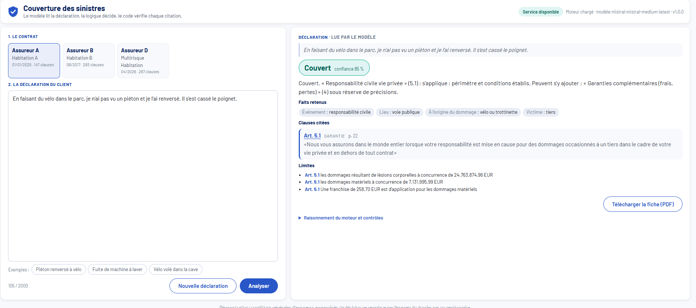
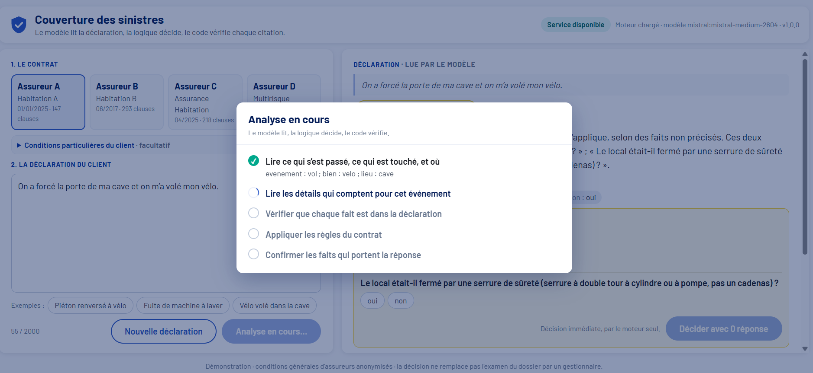

# Couverture sinistre

Dit si un sinistre est couvert par un contrat d'assurance habitation, **pourquoi**, et **sur quelles clauses**. Quand le contrat ne permet pas de trancher, la réponse est **« à préciser »**, avec la question à poser.

> Une réponse assurée sans justification vaut moins qu'un « je ne sais pas » étayé.



*Un piéton renversé à vélo, chez l'assureur A : la décision, les faits que le modèle a lus dans la déclaration, la phrase du contrat qui fonde la réponse (un clic ouvre l'article entier), les plafonds et la franchise. La même réponse se télécharge en [fiche PDF](docs/exemple-fiche.pdf), articles cités joints en entier.*



*Pendant les 4 à 5 secondes de l'analyse, l'écran dit ce qui se fait : lire, vérifier chaque fait, appliquer les règles, confirmer.*

- [Ce que j'ai déjà mis en production](#ce-que-jai-déjà-mis-en-production-et-ce-que-ça-a-donné) : SortirIA, et ce que j'en ai repris ici
- [Note de conception](#note-de-conception) : le besoin, le choix, les résultats, ce qui a été essayé, les limites
- [Démonstration en 5 minutes](#démonstration-en-5-minutes)
- [Installation](#installation) et [utilisation](#utilisation)
- Pour aller plus loin : [la démarche](docs/DEMARCHE.md) (chaque essai et sa mesure, échecs compris), [les explications](docs/EXPLICATIONS.md) (chaque fichier, un lexique), [les mesures](docs/METRIQUES.md), [les consignes versionnées](docs/consignes/README.md), [le suivi](monitoring/README.md)

## Ce que j'ai déjà mis en production, et ce que ça a donné

Ce dépôt est une démonstration : il n'a pas d'utilisateurs. Ce que je sais d'un service en ligne vient de **[SortirIA](https://www.sortiria-montpellier.fr)** ([code](https://github.com/gonzalezcourrier34-glitch/SortirIA), [portfolio](https://gonzalezcourrier34-glitch.github.io)), mon projet personnel, en ligne sur Azure depuis l'automne 2026 : un assistant de sorties pour Montpellier et le bassin de Thau. On écrit sa demande comme on la dirait (« un concert gratuit ce week-end à Sète ») ; la réponse respecte la date, le lieu, le public et le budget. J'y ai tout fait, du cadrage au suivi. C'est un service à faible trafic, pas une production d'entreprise.

| Ce qui a été mesuré | Résultat |
|---|---|
| Contraintes respectées (date, lieu, public, budget) | 98,7 % |
| Pertinence des trois premières sorties, sur mes questions | 97,8 % |
| **Réponses exactes sur 93 questions de vrais testeurs** | **47 %** |
| Accord du juge automatique avec l'humain, sur 135 cartes nouvelles | 91,9 % |
| Temps de réponse au 95e centile | 6,4 s (4,1 s en production) |
| Coût du modèle pour 1 000 questions | 0,12 $ |

Ce que ça a donné, et ce que j'en ai repris ici :

- **L'usage réel a corrigé mes jeux de test.** 97,8 % sur mes questions, 47 % sur celles des testeurs : ils cherchaient aussi des lieux permanents, que mes agendas ne recensent pas. D'où, ici, des jeux fermés écrits par d'autres que moi, sans voir les règles, et une partie test qui ne sert jamais à corriger.
- **Des règles pour ce qui doit être respecté, le modèle pour rédiger.** Dans SortirIA, des règles comprennent la demande et des filtres SQL la font respecter ; Mistral n'écrit qu'à partir des fiches trouvées. C'est le même partage qu'ici : le modèle lit, la logique décide.
- **Les seuils fixés avant de mesurer, et rejoués à chaque push.** L'évaluation tourne en intégration continue ; sous 95 % de contraintes respectées, le déploiement est bloqué. Ici, les bancs ont des portes de la même nature.
- **Un service se surveille.** Contrôle de disponibilité toutes les 3 heures, dérive comparée chaque nuit (les demandes, les réponses, les sources), rapport mensuel, alertes et budget : environ 10 $ par mois.
- **Les données se demandent.** Seulement des sources ouvertes ou autorisées : j'ai écrit aux offices de tourisme, et l'un d'eux a donné son accord écrit, avec ses conditions de citation.

Ce qui me manque encore : tenir une charge réelle, et travailler en équipe sur un produit déjà en production.

## Note de conception

### 1. Le besoin

Un gestionnaire reçoit une déclaration en langage courant et doit dire si le contrat la couvre. Trois choses comptent pour lui, dans cet ordre :

1. **ne pas couvrir à tort** : c'est l'erreur qui coûte ;
2. **pouvoir vérifier** : chaque réponse renvoie à la phrase du contrat, qu'il relit en un clic ;
3. **savoir quoi demander** quand la déclaration ne suffit pas, plutôt qu'une réponse devinée.

Et la question de l'énoncé : que faire à la place du contrat collé dans un chatbot, et comment tenir des centaines de contrats.

### 2. Le choix : le modèle lit, la logique décide, le code vérifie

Coller le contrat dans un chatbot échoue pour trois raisons : l'exclusion qui décide ne ressemble pas à la question, le sens des mots est au lexique du contrat, et rien n'est vérifiable. Le modèle n'a donc ici qu'un rôle : **lire**.

```
Une fois par contrat
  conditions générales (PDF) ─► clauses découpées, contrôlées, stockées en base
                             ─► règles : périmètre, conditions, obligations, exclusions, limites,
                                chacune avec la phrase du contrat qu'elle traduit, mot pour mot
                                (rédigées par Mistral Large, contrôlées par le code, relues)

À chaque sinistre (4 à 5 secondes)
  déclaration ─► Mistral Medium la traduit en faits d'un vocabulaire fermé (vol, vélo, cave, cadenas…)
             ─► chaque fait est vérifié par un autre modèle (Mistral Small) : ce que la déclaration ne dit
                pas est retiré
             ─► le moteur (Prolog, logique à trois valeurs) décide : couvert, non couvert, à préciser
             ─► une réponse ferme doit reposer sur des faits confirmés ; sinon : à préciser, avec la question
             ─► réponse, clauses citées, arbre de preuve
```

Le moteur reprend le raisonnement d'un gestionnaire : un périmètre contraire écarte la garantie ; une exclusion ne retire qu'une garantie qui s'applique ; une obligation de prévention non respectée ne fait refuser que s'il y a un lien causal ; l'assuré établit la garantie, l'assureur l'exclusion. Deux garde-fous tiennent partout : **un doute ne fait jamais couvrir**, et **chaque citation est retrouvée mot pour mot dans le contrat** par le code.

### 3. Les deux questions de l'énoncé

| Question | Réponse | Clause citée |
|---|---|---|
| Vélo volé dans le local commun de l'immeuble, non fermé à clé | **Non couvert** | Art. 2.10-a : « le vol ou le vandalisme dans les parties communes du bâtiment » |
| Bougie laissée sur la table du jardin, fondue par la chaleur | **Non couvert** | Art. 12 : l'excès de chaleur sans embrasement n'est pas un incendie ; le contenu du jardin n'est pas du contenu assuré |

Contrat « Assureur A » (48 pages, 147 clauses). Les réponses attendues ont été établies d'après le texte des conditions générales, avec l'aide de Claude ; elles sont à relire par un juriste.

La question du vélo a aussi été posée à un quatrième contrat (C), ajouté à froid le 22 novembre ([ce qu'il a coûté](#6-tenir-des-centaines-de-contrats)) : **non couvert**, section « Vol », « Les vols des biens déposés dans les locaux à usage commun des occupants de l'immeuble ». La bougie y reste « à examiner » : son incendie n'est pas encore traduit.

### 4. Ce que cela donne

Trois contrats de trois assureurs (anonymisés A, B, D), sur le même moteur. Mistral Medium 3.5 lit (`mistral-medium-2604`), Mistral Small 4 vérifie (`mistral-small-2603`). Mesures du 22 novembre 2026, trois séries dans la journée (13 h 30, 16 h 20, 17 h 25), trois passages par banc ; la fourchette donne les trois séries :

| Banc | Réponses justes | Couverts à tort | Refus à tort |
|---|---|---|---|
| Règles seules, faits exacts (A, les 31 cas de test) | 100 % | 0 | 0 |
| A, partie test du golden set (31 cas jamais utilisés pour régler) | 90 % | 0 à 1 | 0 |
| A, jeu fermé (20 cas écrits sans voir les règles) | 98 à 100 % | 0 à 0,3 | 0 |
| B, jeu fermé (20 cas) | 82 à 85 % | 1 | 0 |
| D, jeu fermé (25 cas) | 93 à 96 % | 0 | 1 |

- **Toutes les erreurs viennent de la lecture**, pas des règles : avec des faits exacts, le moteur ne se trompe pas.
- **Deux erreurs se répètent à chaque passage** : chez B, un vol dans une voiture est couvert alors qu'il fallait demander une précision ; chez D, une crue avec arrêté de catastrophe naturelle est refusée. Les autres sont des « à préciser » de trop : une question au lieu d'une réponse.
- **Un couvert à tort est apparu dans la journée, sans que rien ne change dans la lecture** : un fer à repasser qui brûle une housse, lu « accident » six fois de suite, puis « dégât électrique » deux fois sur trois, puis trois fois sur trois, et alors couvert. La consigne et le vocabulaire envoyés au modèle sont identiques entre ces séries, et la version du modèle aussi (`mistral-medium-2604`, vérifié auprès de Mistral) : à température 0 et graine fixe, le même modèle ne lit pas toujours le même texte de la même façon. C'est l'erreur qui coûte, et la lecture ne la garantit pas à zéro.
- **La lecture varie peu, mais elle varie** : sur 96 déclarations, 0 à 4 changent de réponse d'un passage à l'autre.
- Une analyse prend 4 à 5 secondes (95e centile : 6 à 7 secondes ; un passage à 19 secondes chez B, un appel lent).
- Les jeux sont petits : un écart de 3 ou 4 points entre deux séries n'est pas significatif.
- **Le soir du même jour**, après l'ajout du contrat C et un changement du moteur, les quatre bancs ont été repassés : A 94 % et 100 %, B 85 %, D 96 %, avec les deux mêmes erreurs et aucune nouvelle. Ajouter un contrat n'a pas dégradé les autres, à la précision de ces jeux.
- La **« confiance »** affichée à l'écran (85 % pour un couvert ou un refus, 40 % pour un « à préciser », moins quand une réserve subsiste) est une valeur fixe par type de réponse, pas une probabilité mesurée.

### 5. Ce qui a été essayé, et ce que la mesure a dit

Chaque essai est mesuré avant d'être gardé ; les échecs sont dans [la démarche](docs/DEMARCHE.md), avec leurs chiffres.

| Essai | Ce que la mesure a dit | Décision |
|---|---|---|
| Le modèle seul, sans règles (LegalBench, 133 cas d'assurance) | Il cite juste, mais tranche 90 % des cas que des lecteurs jugent ambigus | Écarté : c'est ce que les règles évitent |
| Des exemples de lecture choisis par similarité (mistral-embed) | Gain chez A ; mais montrés à la première étape, le modèle les recopiait (des denrées ajoutées à un congélateur grillé) | Gardés à la seule étape vérifiée |
| Faire vérifier par le modèle le bien qu'il a lu | Partie test de A : 87 % → 82 % ; il retirait des biens justes | Retiré |
| Un modèle plus fort (Mistral Large) pour la première étape | 17 à 31 secondes par cas, au lieu de 4 | Non retenu |
| Mistral Medium à la place de Small, pour toute l'analyse | Chez A : 85 à 87 % → 90 à 92 %, plus aucun couvert à tort, lecture stable. Mais B et D baissent : comme vérificateur, il refuse 17 fois sur 288 un lieu ou un bien que la déclaration implique | Gardé pour lire, pas pour vérifier |
| Deux modèles : Medium lit, Small vérifie | Les refus à tort de la vérification tombent de 17 à 2 ; A 90 et 98 %, D 96 %, B 82 % | Gardé : c'est la configuration mesurée ci-dessus |
| Remplacer les cas particuliers de la consigne par des exemples | Une phrase retirée sans perte ; une autre faisait perdre un cas chez D | Une sur deux gardée |
| Une graine fixe pour stabiliser la lecture | Faits identiques aux trois passages : 35 déclarations sur 96, contre 30 sans | Sans effet |
| Relire deux fois et comparer | Non codé : les erreurs restantes se répètent à l'identique, deux lectures seraient d'accord sur l'erreur | Écarté |
| Vérifier par le code tout ce qu'on demande au client | 8 défauts d'affichage, vus à l'écran puis par une revue de 267 situations (question hors sujet, déjà répondue, sans réponse possible) ; les bancs ne les voyaient pas | Corrigés, et la revue reste en test |

Ce que cela apprend : un modèle sait dire si un fait est **écrit** ; il ne se corrige pas lui-même sur le choix d'une **catégorie** ; et un bon lecteur n'est pas forcément un bon vérificateur. Les rôles se mesurent un par un, et se confient au modèle qui les tient le mieux.

### 6. Tenir des centaines de contrats

**Ce qui est général.** Vérifié en ajoutant un quatrième contrat (C) le 22 novembre, sans l'avoir préparé :
- **le moteur, la validation des citations, l'API, l'écran et la fiche** n'ont pas changé d'une ligne pour lui ; aucun identifiant de contrat, numéro d'article ou valeur métier n'est écrit dans la logique du code ;
- ce qui est propre à un contrat tient dans **quatre fichiers de données** : son profil de découpage, ses règles, ses variables propres, sa ligne au catalogue ;
- **un vocabulaire à deux étages** : 56 questions communes (l'événement, le bien, le lieu, l'effraction, l'auteur…) et les questions propres à chaque contrat, rangées par le code. Le vol et le bris de glaces de C ont demandé 22 faits : 15 existaient déjà ;
- **les règles sont rédigées par Mistral Large**, puis contrôlées (vocabulaire, citations mot pour mot, cohérence des concepts) et relues. Quatre articles du contrat A font exception : le vol, l'incendie, les dégâts des eaux et les exclusions générales ont été écrits à la main, comme modèle, avant que la rédaction existe ;
- **des jeux fermés** écrits à partir du seul texte du contrat, par deux annotateurs indépendants, pour mesurer sans biais.

**Ce que le quatrième contrat a coûté**, pour deux garanties sur une trentaine (le vol et le bris de glaces) :

| Étape | Coût mesuré | Ce qu'il a fallu faire à la main |
|---|---|---|
| Découpage | environ une heure | Un profil, et du code : ce contrat n'a pas de numéros d'article |
| Rédaction par le modèle | 11 min, puis 2 min 30 pour la même chose | Rien, mais les deux rédactions du même texte ne se ressemblent pas : la plus rapide avait fait moins |
| Contrôles | 22 puis 26 points bloquants | Aucune règle n'est entrée sans relecture |
| Relecture | une vingtaine de règles relues, six réécrites, sept variables créées | Les « objets de valeur » réduits aux bijoux dans les deux rédactions : une définition plus étroite que le texte est une règle bien formée, aucun contrôle ne la voit |
| Défauts du code révélés | cinq, corrigés par une règle générale chacun | Dont les formules d'un autre contrat proposées au modèle, à la rédaction puis à la lecture |

La relecture est le poste qui ne se réduit pas. Elle a été faite ici par l'assistant qui a écrit le code ; le temps d'un relecteur du métier n'a pas été mesuré, et c'est lui qu'il faudrait. Et cette relecture s'est trompée une fois : pour qu'une exclusion soit citée, deux biens exclus déclarés ensemble sont devenus « couverts », pendant une heure, sur un contrat qui n'a pas de jeu de mesure. C'est une comparaison des décisions avant et après, sur des faits tirés au hasard, qui l'a montré. Un contrat ajouté sans jeu de mesure n'est pas vérifié.

**Ce qui n'est pas général.**
- Les consignes de rédaction et de lecture sont écrites pour l'**assurance habitation**, et le socle de la lecture (événement, bien, lieu) convient aux dommages aux biens. Aucun contrat d'une autre branche n'a été essayé.
- Le **découpage** : chaque mise en page a demandé un profil, et une fois sur quatre du code.
- Le contrat C renvoie à ses pages (« reportez-vous à la page 19 »), pas à des articles : ces renvois sont rangés à la main.
- 70 variables lues dans la déclaration restent propres à un seul contrat (`couverture regles --contrat … --bilan`) ; un vrai doublon a été fusionné, sept autres rapprochements demanderaient de réécrire des règles pour un gain plus petit que le bruit des mesures.
- Quatre contrats, dont un partiel, ne prouvent pas cent.

Pour des centaines de contrats, il faut donc une équipe de relecteurs du métier, un outil de relecture, et un jeu de mesure par contrat : pas un bouton.

### 7. Limites

- Les assureurs sont **anonymisés** : dans le dépôt, et dans le texte des clauses que l'écran et la fiche citent, où le nom, l'assisteur, les adresses et les numéros sont remplacés à l'ingestion d'après une liste gardée hors du dépôt. Le texte reste le leur, reconnaissable par qui le connaît : c'est pourquoi les conditions générales ne sont pas redistribuées. La démonstration est en ligne depuis le 23 novembre 2026, derrière un code d'accès donné sur demande : on n'y télécharge pas un contrat, seules les clauses qu'une réponse cite s'y lisent, une à une.
- Les **conditions particulières** du client : la formule et les options se donnent avec la déclaration (à l'écran, ou par l'API), et la réponse en tient compte sans rien demander. Mais le document lui-même n'est pas lu, ni les capitaux ; non renseignée, une réponse qui en dépend reste « à préciser ».
- La **loi applicable** n'est pas traitée : le contrat A se dit régi par la loi belge du 4 avril 2014, d'autres relèvent de la loi luxembourgeoise du 27 juillet 1997 ou du code des assurances français. Ces textes s'imposent aux conditions générales ; le système ne lit que le contrat.
- La **lecture** reste la source de toutes les erreurs. Quand un fait qui porte la réponse n'est pas confirmé, le garde-fou en fait une question, pas une bonne réponse.
- Le moteur n'est pas plus juste que son vocabulaire : il ne sait pas dire « une fuite, mais pas le gel ».
- **Plusieurs biens déclarés ensemble** : la réponse est « couvert » dès qu'un seul entre dans une garantie (une vitre et une télévision brisées : couvert, pour la vitre). Elle nomme les biens qu'une clause exclut, pas ceux qu'aucune garantie ne vise.
- Quand aucune garantie ne s'applique, la réponse cite la clause qui exclut le cas si le contrat en a une (un vase brisé : « les objets en verre autres que des vitres ») ; s'il n'en a pas, elle dit qu'aucune garantie ne s'applique et cite, faute de mieux, les premières garanties du contrat.
- Le **contrat C** n'est traduit que pour le vol et le bris de glaces, avec ses exclusions communes et ses biens non assurés. Ses biens assurés, qui dépendent de la formule et de la qualité d'occupant (propriétaire, locataire), ne sont pas traduits, et il n'a pas de jeu de mesure.
- Chez D, les **mesures de protection contre le vol** ne sont pas traduites : elles ne sont pas vérifiées.
- Seuls des **PDF** de conditions générales sont lus. Un seul document est produit : la fiche d'analyse d'un sinistre, en PDF.
- Les réponses attendues des jeux de référence ont été proposées par des modèles, puis arbitrées sur citations ; elles n'ont pas été validées par un juriste.

## Démonstration en 5 minutes

À répéter avant : `uv run couverture api` dans un terminal, `npm start` dans `frontend`, puis http://localhost:4220. La lecture varie d'un appel à l'autre : rejouer chaque étape une fois avant de la montrer.

| Temps | Ce qu'on montre | Ce qu'on dit |
|---|---|---|
| 0:00 | L'écran d'accueil | Le modèle lit, la logique décide, le code vérifie |
| 0:30 | Assureur A, la question 1 de l'énoncé : le vélo volé dans le local commun | Non couvert ; l'article est cité ; un clic sur son numéro ouvre le texte entier, le passage surligné |
| 1:30 | La question 2 : la bougie sur la table du jardin | Non couvert, pour deux raisons que le contrat écrit lui-même |
| 2:15 | Une déclaration incomplète (un vol sans dire comment le local était fermé) | « À préciser » : la question à poser, les réponses possibles ; la réponse du client donne la décision tout de suite, sans nouvel appel au modèle |
| 3:00 | « Télécharger la fiche (PDF) » | Une page à verser au dossier : la décision, les articles cités, ce qu'il reste à demander |
| 3:15 | La même déclaration sur Assureur B ou D | Autre contrat, autres règles, même moteur |
| 3:45 | `uv run couverture regles --contrat assureur-a-habitation-2025` | Les règles se vérifient sans modèle : vocabulaire, 171 citations retrouvées mot pour mot |
| 4:15 | Le tableau des essais (section 5) | Ce qui a marché, ce qui a été retiré, et pourquoi |
| 4:45 | Les limites (section 7) | Ce que le système ne sait pas faire |

## Installation

Avec [uv](https://docs.astral.sh/uv/) :

```bash
uv sync --extra dev
cp .env.example .env         # puis y mettre la clé Mistral
uv run pytest -q
```

`.env` (jamais versionné) :

```
MISTRAL_API_KEY=votre-clé
COUVERTURE_MODELE=mistral-medium-2604             # lecture des déclarations (version datée : `couverture modele` dit ce que désigne « latest »)
COUVERTURE_MODELE_CONTRAT=mistral-large-4-0       # rédaction des règles : une fois par contrat (ce que « mistral-large-latest » désignait le 22 nov. 2026)
# COUVERTURE_MODELE_SOCLE=mistral-large-latest    # essai (7.118) : un autre modèle pour le seul temps 1 de la lecture
COUVERTURE_MODELE_VERIFICATION=mistral-small-2603     # vérification et confirmation des faits : un autre modèle que la lecture (7.136)
# COUVERTURE_GRAINE=0                             # graine des appels au modèle (0 par défaut ; non : aucune) (7.123)
```

**SWI-Prolog** (gratuit) : `winget install SWI-Prolog.SWI-Prolog` sous Windows, `apt install swi-prolog-nox` sous Linux.

## Utilisation

```bash
uv run couverture ingerer                                   # lit data/contrats/ et remplit la base
uv run couverture analyser --contrat assureur-a-habitation-2025 "Mon vélo a été volé dans ma cave fermée par un cadenas."
uv run couverture regles   --contrat assureur-a-habitation-2025   # vérifie les règles (sans modèle) ; --faits pour un cas
uv run couverture rediger  --contrat assureur-a-habitation-2025 --article 2.2   # Mistral Large rédige, le code contrôle
uv run couverture banc     --contrat assureur-a-habitation-2025   # golden set (112 cas) : règles, lecture, chaîne, portes
uv run couverture exemples --indexer                               # banque d'exemples de lecture (mistral-embed), à refaire si le golden set change
uv run couverture banc     --contrat assureur-a-habitation-2025 --partie test   # les seuls cas de test (data/lecture/partage.json)
uv run couverture api                                       # l'API (FastAPI), documentation sur http://127.0.0.1:8001/docs
```

### L'API

```bash
uv run couverture api                                       # http://127.0.0.1:8001/docs
```

Une API FastAPI, une route par fichier (`src/couverture/api/routes/`), sur le modèle de celle de SortirIA. Clé dans
l'en-tête `x-api-key` (`COUVERTURE_API_KEY` dans `.env` ; sans elle, les routes protégées refusent tout) :

| Route | Rôle |
|---|---|
| `GET /api/v1/sante` | l'API, le moteur et le modèle répondent (publique) |
| `GET /api/v1/contrats`, `/contrats/{id}`, `/contrats/{id}/clauses` | les contrats et leur texte |
| `GET /api/v1/vocabulaire` | les faits que le moteur comprend |
| `POST /api/v1/analyses` | une déclaration, et si on les a la formule et les options du client → couvert, non couvert ou incertain, avec les citations |
| `POST /api/v1/analyses/suivi` | la même analyse, racontée étape par étape pendant qu'elle se fait (flux de lignes JSON) |
| `POST /api/v1/decisions` | des faits → la décision, sans modèle (résout un « incertain ») |
| `POST /api/v1/fiches` | une décision → sa fiche en PDF, à verser au dossier |

### L'interface

```bash
cd frontend
npm install
npm start                                                   # http://localhost:4220 (l'API doit tourner)
```

Angular 21, sur le modèle de l'interface de SortirIA, aux couleurs du système de design public de foyer.lu. Le contrat,
la déclaration, la décision avec ses clauses citées (l'article entier dans une fenêtre, au clic sur son numéro) ; pour
« à préciser », les questions à poser au client, et ses réponses donnent la décision tout de suite. La clé de l'API reste côté serveur (`frontend/proxy.conf.mjs`).

Une réponse « incertain » dit, dans `a_preciser`, quoi demander au client ; ses réponses, ajoutées aux `faits` de la
réponse, se soumettent à `/decisions` : décision immédiate, gratuite, déterministe.

`analyser` donne la décision, le motif, les preuves, les questions à poser et l'**arbre de preuve** du moteur. Autres commandes : `contrats`, `clauses`, `versions`, `modele` (`--help`).

Avec docker : `docker compose up -d --build` lance l'API (8021) et Grafana (3011). L'image de la démonstration en ligne (l'écran et l'API dans un seul conteneur, un code d'accès, une limite d'analyses par jour) se construit avec `deploiement/Dockerfile` ; son en-tête dit comment.

## Arborescence

```
src/couverture/      le code : lecture.py (le modèle lit), prolog.py (le moteur décide), chaine.py (la réponse), fiche.py (le PDF),
                     redaction/ (Mistral Large rédige les règles), banc.py, exemples.py, cli/ et api/ (une
                     commande, une route par fichier), découpage des contrats, base
regles/              moteur Prolog, règles par contrat, vocabulaire (commun.json + un fichier par contrat), faits idéaux des cas
data/contrats/       conditions générales, catalogue.json, SOURCES.md (liens des CG réelles)
data/golden/         le golden set : sinistres, réponses attendues, version figée
config/              manifeste des versions des consignes
docs/                explications, démarche, métriques, archive des consignes
monitoring/          Grafana et guide du suivi
tests/               tests (pytest), sans clé ni réseau ; un second moteur en Python pour le test différentiel
```

`data/base.sqlite` n'est pas versionnée, ni les CG réelles (documents des assureurs) : leurs liens sont dans `data/contrats/SOURCES.md`.

## Mesurer

```bash
uv run couverture banc --contrat assureur-a-habitation-2025 --partie test   # les cas jamais utilisés pour régler
uv run couverture banc --contrat assureur-b-habitation-2017 --jeu ferme     # les cas écrits sans voir les règles
```

Chaque banc fait trois passages, écrit son rapport dans `data/bancs/` et se compare au précédent de même configuration. Il affiche les réponses justes et fausses par type de réponse, les cas instables et le temps par cas. Lancer les bancs l'un après l'autre : en parallèle, ils se ralentissent et faussent les temps. Détail : [docs/METRIQUES.md](docs/METRIQUES.md).
