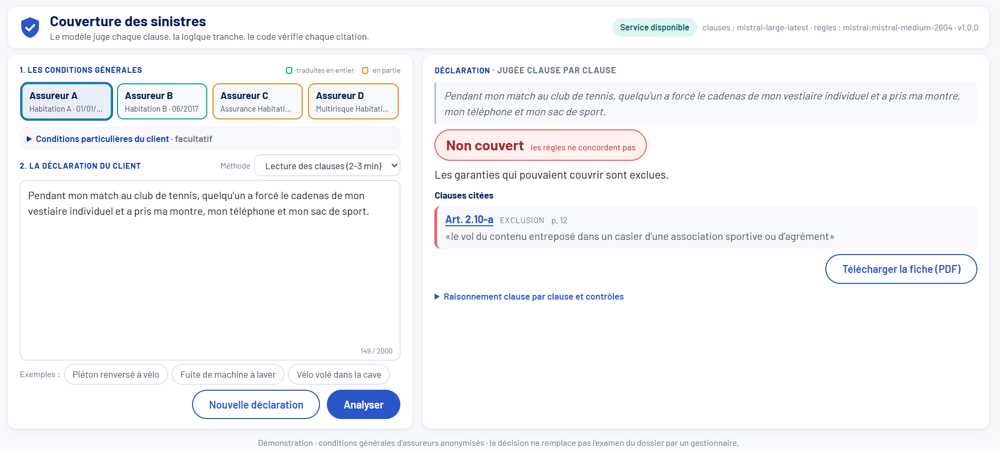
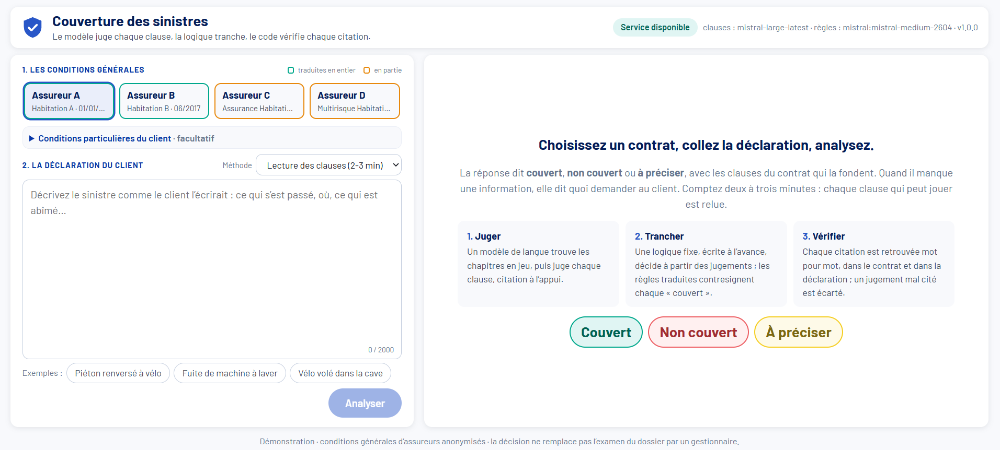
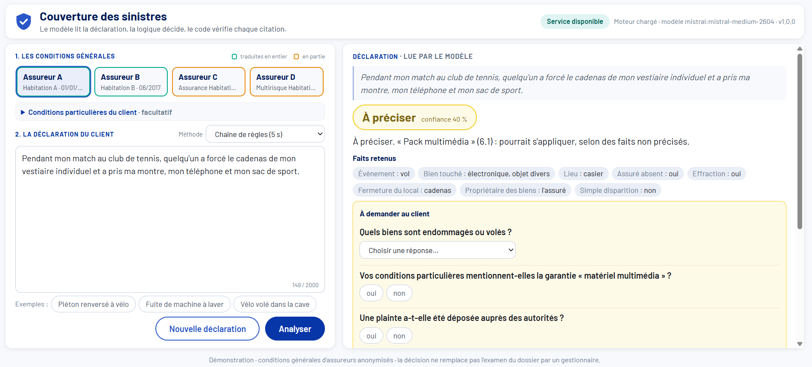

# Couverture sinistre

Dit si un sinistre est couvert par un contrat d'assurance habitation, **pourquoi**, et **sur quelles clauses**. Quand le contrat ne permet pas de trancher, la réponse est **« à préciser »**, avec la question à poser.

> Une réponse assurée sans justification vaut moins qu'un « je ne sais pas » étayé.

**L'histoire en bref.** Ce projet est une petite recherche, menée comme une expérience. Ma question : un système peut-il dire si un sinistre est couvert, en le prouvant par le contrat lui-même, sans jamais promettre à tort ? Ma première hypothèse a été de traduire chaque contrat en règles (Prolog) et de laisser un moteur décider, en quelques secondes. Elle marchait très bien sur les cas qui m'avaient servi à la régler, et beaucoup moins bien sur des cas que je n'avais jamais vus : il lui arrivait de couvrir à tort, parce qu'une règle peut mal traduire le contrat. Cette découverte m'a conduit à une seconde hypothèse : faire juger par Mistral Large les clauses mêmes du contrat, une à une, vérifier chaque citation mot pour mot, calculer la décision dans le code, et faire contresigner chaque « couvert » par la première méthode. Je les ai comparées deux fois, code figé, sur des déclarations écrites par d'autres que moi et jamais vues. À la dernière mesure, **la seconde répond juste 53 fois sur 60 contre 40, et ne couvre jamais à tort, contre 4,7 fois** ; elle demande en échange deux à trois minutes par analyse. Elle est la méthode par défaut depuis le 26 novembre 2026, et les deux restent au choix à l'écran. [Les chiffres](#5-ce-que-cela-donne) ; [l'enquête racontée sans jargon](docs/COMPRENDRE.md).



*Un vestiaire forcé au club de tennis, chez l'assureur A, sur la démonstration en ligne (26 novembre) : la lecture des clauses trouve l'exclusion des casiers d'association sportive et la cite mot pour mot (un clic sur l'article ouvre le texte entier) ; les règles traduites répondaient « à préciser », et l'écran le dit (« les règles ne concordent pas »). La même déclaration par la chaîne de règles est [plus bas](#démonstration-en-5-minutes). Toute réponse se télécharge en [fiche PDF](docs/exemple-fiche.pdf), articles cités joints en entier.*


*L'analyse suivie étape par étape, ici par la chaîne de règles (4 à 5 secondes : lire, vérifier chaque fait, appliquer les règles, confirmer). Par la lecture des clauses, l'écran annonce deux à trois minutes et suit quatre étapes : trouver les chapitres, juger chaque clause, faire contresigner par les règles, décider.*

**Démonstration en ligne** depuis le 23 novembre 2026, sur Azure, derrière un code d'accès donné sur demande. Quatre contrats d'assureurs différents, anonymisés.

**Comment ce projet a été fait.** Avec un assistant de code (Claude) : sa part est visible dans chaque commit. Le cadrage, les arbitrages et les décisions sont les miens ; [la démarche](docs/DEMARCHE.md) les garde dans l'ordre, y compris les fois où une mesure m'a donné tort.

- [Ce que j'ai déjà mis en production](#ce-que-jai-déjà-mis-en-production-et-ce-que-ça-a-donné) : SortirIA, et ce que j'en ai repris ici
- [Note de conception](#note-de-conception) : la question, les deux hypothèses, la méthode d'évaluation, les résultats, ce qui a été essayé, les limites
- [Démonstration en 5 minutes](#démonstration-en-5-minutes)
- [Installation](#installation) et [utilisation](#utilisation)
- **Pour comprendre sans rien connaître au sujet** : [l'enquête racontée](docs/COMPRENDRE.md) : la question et ses enjeux, ce qui la rend difficile, ma méthode d'évaluation, les deux hypothèses (leur structure, leurs forces, leurs faiblesses), ce que les mesures ont révélé, les difficultés et leurs solutions, ce que j'en ai appris
- Pour aller plus loin : [la démarche](docs/DEMARCHE.md) (le raisonnement en onze tournants, puis chaque essai et sa mesure, échecs compris), [les explications](docs/EXPLICATIONS.md) (chaque fichier, un lexique), [les mesures](docs/METRIQUES.md), [les consignes versionnées](docs/consignes/README.md), [le suivi](monitoring/README.md)

## Ce que j'ai déjà mis en production, et ce que ça a donné

Ce dépôt est une démonstration : il n'a pas d'utilisateurs. Ce que je sais d'un service en ligne vient de **[SortirIA](https://www.sortiria-montpellier.fr)** ([code](https://github.com/gonzalezcourrier34-glitch/SortirIA), [portfolio](https://gonzalezcourrier34-glitch.github.io)), mon projet personnel, en ligne sur Azure depuis l'automne 2026 : un assistant de sorties pour Montpellier et le bassin de Thau. On écrit sa demande comme on la dirait (« un concert gratuit ce week-end à Sète ») ; la réponse respecte la date, le lieu, le public et le budget. J'y ai tout fait, du cadrage au suivi. C'est un service à faible trafic, pas une production d'entreprise.

| Ce qui a été mesuré | Résultat |
|---|---|
| Contraintes respectées (date, lieu, public, budget) | 98,7 % |
| Pertinence des trois premières sorties, sur mes questions | 97,8 % |
| **Réponses exactes sur 93 questions de vrais testeurs** | **47 %** |
| Accord du juge automatique avec l'humain, sur 135 cartes nouvelles | 91,9 % |
| Temps de réponse au 95e centile | 6,4 s (4,1 s en production) |
| Coût du modèle pour 1 000 questions | 0,12 $ |

Ce que ça a donné, et ce que j'en ai repris ici :

- **L'usage réel a corrigé mes jeux de test.** 97,8 % sur mes questions, 47 % sur celles des testeurs : ils cherchaient aussi des lieux permanents, que mes agendas ne recensent pas. D'où, ici, des jeux fermés écrits par d'autres que moi, sans voir les règles, et une partie test qui ne sert jamais à corriger.
- **Des règles pour ce qui doit être respecté, le modèle pour rédiger.** Dans SortirIA, des règles comprennent la demande et des filtres SQL la font respecter ; Mistral n'écrit qu'à partir des fiches trouvées. C'est le même partage qu'ici : le modèle lit, la logique décide.
- **Les seuils fixés avant de mesurer, et rejoués à chaque push.** L'évaluation tourne en intégration continue ; sous 95 % de contraintes respectées, le déploiement est bloqué. Ici, les bancs ont des portes de la même nature.
- **Un service se surveille.** Contrôle de disponibilité toutes les 3 heures, dérive comparée chaque nuit (les demandes, les réponses, les sources), rapport mensuel, alertes et budget : environ 10 $ par mois.
- **Les données se demandent.** Seulement des sources ouvertes ou autorisées : j'ai écrit aux offices de tourisme, et l'un d'eux a donné son accord écrit, avec ses conditions de citation.

Ce qui me manque encore : tenir une charge réelle, et travailler en équipe sur un produit déjà en production.

## Note de conception

### 1. La question, ses enjeux, et le critère fixé avant de mesurer

Un gestionnaire reçoit une déclaration en langage courant (« on m'a volé mon vélo dans le local commun ») et doit dire si le contrat la couvre. Pour cela, il relit cinquante à cent pages de conditions générales : la garantie, ses conditions, ses exclusions, le lexique, les exceptions aux exclusions. Une erreur coûte dans les deux sens : un « couvert » à tort est un paiement que le contrat ne prévoit pas, un refus à tort est un client lésé, et une réponse qu'on ne peut pas justifier ne vaut rien, même juste. L'énoncé posait deux questions : que faire à la place du contrat collé dans un assistant conversationnel, et comment tenir des centaines de contrats.

Ma question de recherche : **un système peut-il faire ce travail avec le gestionnaire, de façon vérifiable ?** Avant de construire quoi que ce soit, j'ai fixé ce qui compterait pour le juger, dans cet ordre :

1. **ne pas couvrir à tort** : c'est l'erreur qui coûte ;
2. **pouvoir vérifier** : chaque réponse renvoie à la phrase du contrat, qu'on relit en un clic ;
3. **savoir quoi demander** quand la déclaration ne suffit pas, plutôt qu'une réponse devinée.

Le premier essai, donner le contrat et la déclaration à un modèle et lui demander la réponse, échoue précisément là. L'exclusion qui décide ne ressemble pas à la question (un vélo volé dans le hall relève des « parties communes du bâtiment ») ; le sens des mots est au lexique du contrat (un cadenas n'est pas une « serrure de sûreté ») ; et le raisonnement du modèle ne se vérifie pas. Sur un banc public de cas d'assurance, il tranchait 90 % des cas que des lecteurs humains jugent ambigus. J'en ai tiré trois garde-fous, communs à mes deux hypothèses : **pas de réponse sans preuve** (chaque citation est retrouvée mot pour mot par le code), **un doute ne fait jamais couvrir**, et **le code tranche, pas le modèle**.

### 2. Deux hypothèses, l'une née de l'échec de l'autre

**Ma première hypothèse : le modèle lit, la logique décide.** Si je traduis chaque contrat, une fois pour toutes, en règles qu'un programme sait appliquer, le modèle n'a plus qu'à transformer la déclaration en faits, et la décision devient un calcul, reproductible et traçable.

```
Une fois par contrat
  conditions générales (PDF) ─► clauses découpées, contrôlées, stockées en base
                             ─► règles : périmètre, conditions, obligations, exclusions, limites,
                                chacune avec la phrase du contrat qu'elle traduit, mot pour mot
                                (rédigées par Mistral Large, contrôlées par le code, relues)

À chaque sinistre (4 à 5 secondes)
  déclaration ─► Mistral Medium la traduit en faits d'un vocabulaire fermé (vol, vélo, cave, cadenas…)
             ─► chaque fait est vérifié par un autre modèle (Mistral Small) : ce que la déclaration ne dit
                pas est retiré
             ─► le moteur (Prolog, logique à trois valeurs) décide : couvert, non couvert, à préciser
             ─► une réponse ferme doit reposer sur des faits confirmés ; sinon : à préciser, avec la question
             ─► réponse, clauses citées, arbre de preuve
```

Le moteur reprend le raisonnement d'un gestionnaire : un périmètre contraire écarte la garantie ; une exclusion ne retire qu'une garantie qui s'applique ; une obligation de prévention non respectée ne fait refuser que s'il y a un lien causal ; l'assuré établit la garantie, l'assureur l'exclusion.

**Ce que la mesure m'a appris.** Sur les cas qui m'avaient servi à régler les règles : 90 à 100 % de réponses justes. Sur des cas écrits par d'autres, d'après le seul texte des contrats : 58 % chez B, puis, après corrections, 38 réponses justes sur 60 et 7 couverts à tort sur un troisième jeu. Le système ne répondait jamais sans preuve, mais la preuve était celle de la règle, et une règle peut mal traduire le contrat. Deux tours de corrections qui ne font pas monter un jeu neuf désignent la méthode, pas une liste de défauts.

**Ma seconde hypothèse : le modèle juge chaque clause, la logique tranche, les règles contresignent.** Si le modèle lit le texte même du contrat, une clause que la traduction a manquée peut encore être vue. Pour ne pas retomber dans le premier piège, je ne lui demande jamais « est-ce couvert ? » : il juge les clauses une à une, je vérifie chaque citation, et je calcule la décision. Un article sur les dossiers de sinistre m'a donné la pièce qui manquait : une absence ne se trouve pas par une recherche, seulement si l'on a écrit d'avance ce qui était attendu. J'ai donc écrit, pour chaque garantie, les clauses qu'un gestionnaire doit relire, et le code vérifie que chacune a été jugée.

```
À chaque sinistre, lecture des clauses (2 à 3 minutes)
  déclaration ─► Mistral Large désigne les chapitres en jeu ; le code compose le dossier
                (ces chapitres, plus les exclusions générales, les obligations, les définitions,
                 et la liste des clauses attendues)
             ─► Mistral Large juge chaque clause : couvre, exclut, limite, à vérifier (avec la question), sans effet,
                avec une phrase du contrat et une phrase de la déclaration
             ─► le code vérifie chaque citation et redemande une clause attendue restée sans jugement
             ─► une logique fixe tranche : une exclusion citée l'emporte, un doute donne « à préciser »
             ─► la chaîne de règles contresigne : « couvert » seulement si elle le dit aussi, ou si chacun
                de ses obstacles est écarté par une citation de la déclaration
```

| | Première méthode (règles) | Seconde méthode (clauses) |
|---|---|---|
| Ses forces | Quelques secondes, presque rien par analyse ; reproductible ; un arbre de preuve condition par condition | Lit le texte même : une clause oubliée par la traduction est encore vue ; aucun couvert à tort sur le dernier jeu neuf |
| Ses faiblesses | Ne vaut que ce que vaut sa traduction ; le vocabulaire est un goulot ; chaque contrat demande traduction et relecture | Deux à trois minutes et 8 à 10 centimes ; moins stable ; une citation exacte peut être hors de propos ; dépend encore des règles pour couvrir |

Les deux restent dans le produit : à l'écran, une liste « Méthode » sur la ligne de la déclaration (lecture des clauses par défaut, ou chaîne de règles) ; côté serveur, `COUVERTURE_METHODE=regles` fait de la chaîne la méthode par défaut. [Les deux méthodes racontées, avec leurs schémas](docs/COMPRENDRE.md).

### 3. Comment j'évalue

La méthode d'évaluation est la partie qui a le plus changé mes conclusions. Elle tient en trois idées.

**Les erreurs ne se valent pas.** Je ne lis pas un score unique, mais, dans cet ordre : les **couverts à tort** (visés à zéro), les **refus à tort**, les **réponses justes** (la réponse attendue, ou une seconde réponse jugée défendable par les annotateurs) et les **exactes** (sans tolérance), les **« à préciser » au lieu d'une réponse** (l'erreur la moins chère, mais un système qui ne répond jamais n'erre jamais et ne sert à rien), les **cas instables** d'un passage à l'autre, la **durée** (médiane et 95e centile) et le **coût**. Chaque banc a des portes fixées à l'avance (aucun couvert à tort, au plus un refus à tort, au moins 85 % de justes) et échoue si l'une ne passe pas. Pour la première méthode, la lecture se mesure à part, avec des faits idéaux écrits à la main : on sait ainsi si une erreur vient des règles ou de la lecture.

**Des cas jamais regardés.** Un jeu qui a servi à corriger flatte ce qu'on a corrigé. Au-delà du jeu de mise au point, j'ai donc fait écrire six jeux de soixante déclarations (vingt par contrat) par des annotateurs qui n'avaient lu que le texte des contrats, jamais mes règles : des agents Claude plutôt que moi, parce que je connais les règles. Un second avis indépendant répond sans voir le premier ; un désaccord est arbitré sur le texte. Au dernier jeu, le second avis n'est plus Mistral Large, qui lit dans la méthode mesurée.

**Une mesure, une seule fois.** Le code est figé avant ; le jeu est passé une fois (trois pour la chaîne de règles, rapide et un peu variable) ; les chiffres s'écrivent tels quels ; le jeu devient alors « vu », et un nouveau tour de corrections en demande un neuf. Et pour chaque règle que j'essaie, le critère qui la fera garder ou retirer est écrit avant de la mesurer.

Ce que cette méthode ne garantit pas : les réponses attendues viennent d'annotateurs automatiques qui s'accordent, pas d'un juriste ; et vingt cas par contrat ne distinguent pas un écart de deux ou trois réponses. Détail des métriques et des seuils : [la fiche métriques](docs/METRIQUES.md) ; le raisonnement : [COMPRENDRE, section 3](docs/COMPRENDRE.md#3-comment-je-juge--la-méthode-et-les-métriques-dévaluation).

### 4. Les deux questions de l'énoncé

Posées aux quatre contrats, sur la démonstration en ligne, le 24 novembre :

| Contrat | Vélo volé dans le local commun de l'immeuble, non fermé à clé | Bougie laissée sur la table du jardin, fondue par la chaleur |
|---|---|---|
| A | **Non couvert.** Art. 2.10-a : « le vol ou le vandalisme dans les parties communes du bâtiment » | **Non couvert** : aucune garantie ne s'applique |
| B | **À préciser** : l'option « dommages aux biens » est-elle souscrite ? La garantie vol de base refuse (art. 3.1.6.2, « couloirs et passages d'accès ») ; l'option couvre un vélo volé sous la surveillance directe de l'assuré (art. 3.3.1.1). Dit « laissé sans surveillance », le vélo est **non couvert** | **À préciser** : une question sur le bris de vitrages, que la déclaration n'appelle pas |
| C | **Non couvert.** Section « Vol » : l'exclusion des « biens déposés dans les locaux à usage commun des occupants de l'immeuble », ou la condition d'effraction non remplie, selon la lecture | **À examiner par un gestionnaire** |
| D | **Non couvert.** Art. 2.5-a : la garantie demande une effraction, une escalade, des menaces ou un vol des clés | **À examiner par un gestionnaire** |

**Le vélo** est refusé chez A, C et D, pour des raisons que chaque contrat écrit à sa façon : une exclusion des parties communes chez A et C, une condition d'effraction chez D. C'est ce que le système doit savoir faire. Chez B, la réponse a changé le 24 novembre, quand l'option « dommages aux biens » a été traduite : elle couvre le vol d'un vélo sous la surveillance directe de l'assuré, où qu'il soit. Une déclaration qui dit seulement « volé dans le hall » ne permet plus de refuser : la réponse est « à préciser », et c'est la lecture exacte du contrat, pas un recul. Chez C, deux raisons valent en même temps, et la réponse n'en montre qu'une : le matin du 24 novembre l'exclusion, deux heures plus tard la condition, parce que la lecture avait retenu en plus « pas de violences ». La décision ne change pas ; la phrase citée, si.

**La bougie** est le cas difficile, et la réponse est moins bonne. La déclaration est lue comme un dommage accidentel. Chez A, aucune garantie ne porte sur ce dommage : « non couvert », ce qui est la bonne décision, mais sans la phrase du lexique qui l'expliquerait le mieux (un excès de chaleur « sans qu'il y ait embrasement » n'est pas un incendie). Chez C et D, le dommage accidentel relève de garanties qui ne sont pas traduites en règles : le système le dit et passe la main, plutôt que de répondre. Chez B, l'accident est traduit depuis le 24 novembre : la réponse est « à préciser », avec une question sur le bris de vitrages. Rien dans la déclaration ne parle de vitrage : la question est de trop, et un refus aurait été la réponse attendue. Voir [les limites](#8-limites).

Les réponses attendues ont été établies d'après le texte des conditions générales, avec l'aide de Claude ; elles sont à relire par un juriste.

### 5. Ce que cela donne

**La mesure finale : le jeu « cinq », après le dernier tour de corrections (26 novembre).** Soixante déclarations neuves, vingt par contrat (A, B, D), écrites par trois annotateurs qui n'avaient lu que le texte des contrats, et jugées à l'aveugle par trois autres (Claude, pas Mistral Large : c'est lui qui lit dans la seconde méthode). 59 accords sur 60, un désaccord arbitré sur le texte. Code figé avant (commit `de9ed60`), jeu passé une seule fois, rien corrigé ensuite (démarche 7.215).

| Jeu « cinq », 60 cas jamais vus | Chaîne de règles (3 passages) | Lecture des clauses (1 passage) |
|---|---|---|
| A | 15,7 sur 20 | 20 sur 20 |
| B | 14,3 sur 20 | 19 sur 20 |
| D | 10,3 sur 20 | 14 sur 20 |
| **Réponses justes** | **40,3 sur 60** | **53 sur 60** |
| **Couverts à tort** | **4,7** | **0** |
| Refus à tort | 6 | 1 |
| « À préciser » au lieu d'une réponse | 9 | 6 |
| Durée d'une analyse | 3,5 à 5,2 s (médiane) | 177 s (médiane ; 71 à 366 s) |

- **Treize réponses justes de plus, sur le même jeu.** Sur « quatre », l'écart (trois) ne se distinguait pas du hasard ; celui-ci est quatre fois plus grand, et il va dans le même sens sur les trois contrats.
- **Aucun couvert à tort.** La chaîne de règles en fait 4,7 sur les mêmes cas.
- **Un seul refus à tort** (`c-b08`) : des clés volées dans un sac, au café ; on demandait le changement des serrures, et la lecture a appliqué l'exclusion des vols à la tire hors du bâtiment.
- **Les six « à préciser » sont tous chez D, et tous du même type** : la lecture conclut « couvert » à raison, la chaîne de règles de D, traduite en partie, ne suit pas, et la contresignature rend « à préciser ». C'est le prix connu de ce contre-pouvoir (déjà six écarts sur quinze au jeu « quatre »). Je ne le change pas : je l'ai décidé avant la mesure, et le changer maintenant reviendrait à régler sur le jeu qui mesure.
- **Entre les deux jeux**, la lecture des clauses passe de 45 à 53, la chaîne de règles de 42 à 40. Deux jeux différents ne se comparent pas au point près ; mais la chaîne, à peu près inchangée entre-temps, ne trouve pas ce jeu-ci plus facile, ce qui laisse penser que le gain vient du dernier tour de corrections (démarche 7.210 à 7.214).
- **La même réponse deux fois ? Pas toujours** (26 novembre au soir). J'ai repassé dix cas par contrat deux fois de plus, comme la chaîne de règles passe chaque jeu trois fois. Sur ces trente cas, les trois passes donnent 26, 25 et 23 réponses justes : la première passe avait plutôt eu de la chance, et le niveau à attendre est plus près de 82 % que de 88 %. Sept cas sur trente changent de réponse d'une passe à l'autre, bien plus que la chaîne de règles. Mais **aucun ne passe de « couvert » à « non couvert » ou l'inverse** : chaque fois, une réponse franche devient « à préciser », ou l'inverse. Sur quatre-vingt-dix analyses, toujours aucun couvert à tort, et un seul refus à tort. L'instabilité va vers la prudence ; elle coûte des questions au client, pas des promesses fausses (démarche 7.221).

**Après l'envoi : deux corrections mesurées (27 novembre).**

- **Ajouter à la lecture les garanties que trouvent les règles** : la piste de l'instabilité. Trois passes de plus sur « cinq » : 82 % avant comme après, autant de cas instables. Pas de gain : la garantie manquait rarement au dossier. Une autre cause est apparue : une erreur passagère du fournisseur (520) que le code ne relançait pas ; il la relance maintenant (démarche 7.224 et 7.225).
- **Deux règles de lecture contre les « couvert » trop rapides** : une cause que l'assuré donne comme seulement probable n'est pas établie ; une garantie qui pose une condition ne couvre que si la déclaration la remplit. Mesurées sur un sixième jeu, « six », écrit pour se jouer sur ces détails : **46 réponses justes sur 60, un seul couvert à tort**. Repassés avec l'ancienne consigne, les cas laissés « à préciser » auraient donné trois couverts à tort de plus, et deux réponses justes de plus. Je garde les deux règles : mieux vaut une question qu'une promesse fausse. Défaut vu : une obligation de l'assuré (déclarer un déménagement) est parfois prise pour une condition de la garantie ; je ne le corrige pas sur le jeu qui l'a montré (démarche 7.226 et 7.227).

**La première mesure : le jeu « quatre », les deux méthodes comparées (25 novembre au soir).** Soixante déclarations, vingt par contrat (A, B, D), écrites d'après le seul texte des contrats et jugées à l'aveugle par deux autres annotateurs (Mistral Large et Claude) : les trois avis concordent sur les soixante cas. J'ai figé le code avant, passé le jeu une seule fois, et je n'ai rien corrigé ensuite (démarche 7.207).

| Jeu « quatre », 60 cas jamais vus | Chaîne de règles (3 passages) | Lecture des clauses (1 passage) |
|---|---|---|
| A | 12,3 sur 20 | 16 sur 20 |
| B | 16,7 sur 20 | 16 sur 20 |
| D | 13 sur 20 | 13 sur 20 |
| **Réponses justes** | **42 sur 60** | **45 sur 60** |
| **Couverts à tort** | **4,3** | **1** |
| Refus à tort | 2 | 4 |
| « À préciser » au lieu d'une réponse | 8,7 | 10 |
| Durée d'une analyse | 3,6 s (médiane) | 100 à 260 s |

- **Autant de réponses justes** : trois de plus sur soixante, ce que ce jeu ne permet pas d'affirmer. L'écart mesuré sur le jeu « neuf » (48 contre 38) tenait en partie aux réglages faits sur lui.
- **Beaucoup moins de couverts à tort**, l'erreur qui coûte : un au lieu de plus de quatre. C'est ce qui a décidé mon choix.
- **Plus de refus à tort** (quatre au lieu de deux), et une attente de deux à trois minutes. Six des quinze écarts de la lecture des clauses viennent de la contresignature : la lecture couvre à raison, les règles se trompent, la réponse devient « à préciser ».
- **Ce qui n'est pas mesuré** : la lecture des clauses sans la contresignature des règles, c'est-à-dire sur un contrat qu'on n'aurait pas traduit. C'est la condition pour dire qu'elle s'étend à un nouveau contrat sans travail de traduction.

**Ma première hypothèse, mesurée jeu par jeu : comment je suis arrivé à la seconde.** Trois contrats de trois assureurs (anonymisés A, B, D), sur le même moteur. Mistral Medium 3.5 lit (`mistral-medium-2604`), Mistral Small 4 vérifie (`mistral-small-2603`). Mesures du 22 novembre 2026, trois séries dans la journée (13 h 30, 16 h 20, 17 h 25), trois passages par banc ; la fourchette donne les trois séries :

| Banc | Réponses justes | Couverts à tort | Refus à tort |
|---|---|---|---|
| Règles seules, faits exacts (A, les 31 cas de test) | 100 % | 0 | 0 |
| A, partie test du golden set (31 cas jamais utilisés pour régler) | 90 % | 0 à 1 | 0 |
| A, jeu fermé (20 cas écrits sans voir les règles) | 98 à 100 % | 0 à 0,3 | 0 |
| B, jeu fermé (20 cas), dont 2 cas vus (voir plus bas) | 78 à 90 % | 0 (1 jusqu'au 24 nov. au soir) | 0 |
| D, jeu fermé (25 cas) | 93 à 96 % | 0 | 1 |

**Et sur des cas que personne n'avait vus (25 novembre, 11 h 30).** Les jeux ci-dessus ont accompagné une semaine de réglages, et trois de leurs cas ont fini par servir à corriger une règle. Un second jeu a donc été écrit le dernier jour, de la même façon (deux annotateurs à l'aveugle, d'après le seul texte des contrats ; 59 accords sur 60, un désaccord arbitré), et mesuré une seule fois, sans rien régler ensuite :

| Banc « aveugle » (20 cas par contrat, 3 passages) | Réponses justes | Couverts à tort | Refus à tort |
|---|---|---|---|
| A | 95 % | 0 | 0 |
| B | 58 % | 1 à 2 | 2 à 3 |
| D | 78 % | 2 | 1 |

- **C'est le chiffre à retenir pour un contrat qu'on vient de brancher** : A tient (95 %, aucune erreur dans un sens ni dans l'autre) ; B et D tombent nettement sous leurs jeux fermés (90 % et 96 %), et couvrent à tort.
- **Les couverts à tort** : chez B, un rocher tombé d'un talus (le contrat exclut les chutes de pierres pour toutes les garanties), à chaque passage, et une tablette volée dans une voiture, une fois sur trois ; chez D, des bijoux volés (ils relèvent d'une option) et un accident de trottinette électrique (soumise à l'assurance obligatoire), à chaque passage.
- **Les autres erreurs** sont surtout des « à préciser » là où le texte suffisait, et chez B trois refus à tort (une conduite rompue dans une cloison, un trampoline emporté par la tempête, la vitre d'une salle louée).
- **Cette mesure a été faite et enregistrée avant toute correction** (commit du 25 novembre, 11 h 48). Ensuite seulement j'ai regardé pourquoi : à peu près la moitié des erreurs venait des règles (les exclusions communes de B jamais traduites, deux garanties de base de B traitées en options, les bijoux de D couverts sans leur option), l'autre du vocabulaire donné à la lecture (une trottinette électrique lue comme un vélo, un trampoline comme du matériel de sport). Neuf corrections, chacune écrite comme une règle générale (démarche 7.186). La phrase « toutes les erreurs viennent de la lecture », plus bas, ne vaut donc que pour les anciens jeux.
- **Ce jeu est maintenant un jeu « vu »** : le gain des corrections se mesure sur un troisième, `data/neuf`, écrit de la même façon après elles.

**Le troisième jeu (25 novembre, 12 h 37), mesuré une fois après ces corrections.** Soixante autres déclarations, écrites de la même façon, avec une consigne de plus : chercher des situations moins courantes que celles du second jeu (57 accords sur 60 entre les deux annotateurs, trois désaccords arbitrés sur le texte).

| Banc « neuf » (20 cas par contrat, 3 passages) | Réponses justes | Couverts à tort | Refus à tort |
|---|---|---|---|
| A | 60 % | 4 | 1 |
| B | 50 % | 2 | 0 |
| D | 80 % | 1 | 1 |

- **Les corrections du midi n'ont pas suffi** : sur des situations moins courantes, B ne fait pas mieux (50 %), et A, qui tenait à 95 % sur le second jeu, tombe à 60 % avec quatre sinistres couverts à tort. Seul D se maintient (80 %).
- **Les deux jeux ne sont pas de même difficulté** (le troisième cherche l'inhabituel), donc l'écart ne mesure pas seulement les corrections. Mais la conclusion ne dépend pas de cette nuance : **sur des cas que je n'ai jamais regardés, le système répond juste une fois sur deux à quatre fois sur cinq, et il lui arrive de couvrir à tort.** Les 94 à 100 % du premier tableau sont ceux de jeux qui ont accompagné les réglages.
- **Un second tour de corrections** a suivi, limité aux sinistres couverts à tort (démarche 7.187) ; le troisième jeu est donc « vu » à son tour. Ce tour n'a pas été mesuré : deux tours de corrections qui ne font pas monter un jeu neuf désignent la méthode, pas une liste de défauts. La décision est en cours de refonte (démarche 7.188), et le quatrième jeu, `data/quatre`, écrit et jamais ouvert, a été gardé pour mesurer la nouvelle méthode : c'est le tableau en tête de cette section.
- Ce que le système garde de solide dans les trois jeux : chaque réponse cite la clause qui la fonde, et le moteur, sur des faits exacts, applique les règles sans erreur. Ce qui manque est en amont : des clauses pas encore traduites ou traduites trop large, et un vocabulaire de lecture qui ne connaît pas encore assez de situations.
- **Un cas de D ressemble à un exemple de lecture** écrit avant lui (des tags sur un mur, `av-d13` et `ex-d14`) : l'annotateur ne l'avait pas vu, c'est un hasard, mais ce cas a pu être aidé. Il reste dans le jeu, la ressemblance est déclarée dans `data/lecture/proches_declares.json` ; sans lui, D resterait à 77 %.
- Ce que cela dit : la méthode empêche de répondre sans preuve, pas de mal traduire un contrat. Les jeux qui ont servi pendant les réglages flattent le système ; la relecture par un juriste et un jeu neuf à chaque contrat restent nécessaires.

<details>
<summary><b>Le journal de mes mesures de la première méthode, jour par jour (22 au 25 novembre)</b> : chaque lot de règles, et ce que les bancs en ont dit</summary>

- **Sur ces cinq bancs, toutes les erreurs viennent de la lecture**, pas des règles : avec des faits exacts, le moteur ne se trompe pas.
- **Une erreur se répète à chaque passage** : chez D, une crue avec arrêté de catastrophe naturelle est refusée. Chez B, un vol dans une voiture a été couvert à tort à chaque passage jusqu'au 24 novembre au soir, puis corrigé en regardant ce cas (voir la dernière ligne ci-dessous). Les autres sont des « à préciser » de trop : une question au lieu d'une réponse.
- **Un couvert à tort est apparu dans la journée, sans que rien ne change dans la lecture** : un fer à repasser qui brûle une housse, lu « accident » six fois de suite, puis « dégât électrique » deux fois sur trois, puis trois fois sur trois, et alors couvert. La consigne et le vocabulaire envoyés au modèle sont identiques entre ces séries, et la version du modèle aussi (`mistral-medium-2604`, vérifié auprès de Mistral) : à température 0 et graine fixe, le même modèle ne lit pas toujours le même texte de la même façon. C'est l'erreur qui coûte, et la lecture ne la garantit pas à zéro.
- **La lecture varie peu, mais elle varie** : sur 96 déclarations, 0 à 4 changent de réponse d'un passage à l'autre.
- Une analyse prend 4 à 5 secondes (95e centile : 6 à 7 secondes ; un passage à 19 secondes chez B, un appel lent).
- Les jeux sont petits : un écart de 3 ou 4 points entre deux séries n'est pas significatif.
- **Le soir du même jour**, après l'ajout du contrat C et un changement du moteur, les quatre bancs ont été repassés : A 94 % et 100 %, B 85 %, D 96 %, avec les deux mêmes erreurs et aucune nouvelle. Ajouter un contrat n'a pas dégradé les autres, à la précision de ces jeux.
- **Le 24 novembre**, veille de la livraison, les quatre bancs ont été repassés trois fois, avant et après deux retouches de la phrase de réponse (qui ne changent aucune décision) : A 94 % (partie test) et 98 à 100 % (jeu fermé), B 85 %, D 96 %. Les deux erreurs répétées sont là ; le fer à repasser est couvert à tort zéro ou une fois sur trois. Les chiffres restent dans les fourchettes du tableau.
- **Le même jour à midi**, après l'ajout de la réponse par sinistre : A 94 % et 100 %, D 96 %, inchangés ; B 78 %. Rejoué aussitôt sur le code d'avant, B donne 82 % : la baisse ne vient pas de l'ajout. Un cas de B (une chaudière qui fuit deux semaines après la signature), refusé à raison neuf fois sur neuf le matin, reçoit maintenant « à préciser » deux fois sur trois avec l'ancien code comme avec le nouveau : le modèle qui confirme les faits ne retrouve plus toujours le bien dans la déclaration. La fourchette de B est élargie en conséquence ; ses erreurs restent des questions de trop, plus le vol dans la voiture.
- **Le même jour, en début d'après-midi**, après l'entrée de l'assistance dans les règles de A (2.13) et de B (3.1.12) : A 94 % (partie test) et 100 % (jeu fermé), B 83 %, D 96 %. Un premier passage avait donné un couvert à tort sur le jeu fermé de A : un dépannage serrurier dont la déclaration ne dit pas qui l'a commandé. La règle, que je venais d'écrire, ne posait pas la question ; elle la pose maintenant, chez A comme chez B. Ce cas du jeu fermé (`f-a20`) a donc servi à corriger une règle : pour l'assistance de A, il n'est plus un cas jamais vu, et le 100 % le compte.
- **Puis six exclusions de la responsabilité civile de A**, classées « rares » depuis le 20 novembre, deviennent des règles (chasse, gibier, ivresse et violence, terrorisme, nucléaire, pollution graduelle). Elles ajoutent cinq faits à lire dans toute déclaration de responsabilité civile, pour les quatre contrats. Les quatre bancs repassés : A 94 % et 100 %, B 83 %, D 96 %. Aucun n'a bougé.
- **En fin d'après-midi**, après le reste de A (neuf autres exclusions jusque-là classées « rares », dans la responsabilité civile immeuble, la défense et recours et la vie privée) et trois articles de B (assistance pour petits travaux, protection juridique de l'immeuble, option « dommages aux biens ») : A 94 % et 100 %, B 87 à 88 %, D 95 %. Sur B, le cas de la chaudière redevient juste. Sur D, un cas est juste deux fois sur trois : l'étape de confirmation écarte une fois le bien, lu comme avant. L'option « dommages aux biens » ajoute cinq valeurs au vocabulaire des biens, lu par les quatre contrats : sur 900 jeux de faits tirés au hasard, aucune décision ne change hors des vélos, des bijoux et des nouveaux biens.
- **Le soir**, deux lots sur B. *Le premier* : les exclusions de la responsabilité civile, de la protection juridique et des catastrophes naturelles jusque-là classées « rares » deviennent des règles, et la responsabilité civile chasse (4.1.2) est traduite. A 94 % et 100 %, B 85 %, D 95 %. *Le second* : l'événement « accident » (un objet qui tombe, une maladresse) est traduit chez B, ce qui lève la mention « à examiner par un gestionnaire » pour ces déclarations. B tombe à 77 %, avec un deuxième couvert à tort : un violon tombé de son pupitre, que seule l'option « dommages aux biens » couvre, recevait « couvert, sous réserve de l'option » au lieu de « à préciser ». L'erreur était dans une règle écrite l'après-midi : deux garanties que le contrat range sous un titre « Option » étaient traitées comme des garanties de base. L'option est maintenant une question, comme pour la responsabilité civile. Repassé : B 85 %, un couvert à tort (le vol dans la voiture), deux cas instables. Ce cas du jeu fermé (`f-b19`) a servi à corriger une règle : il n'est plus un cas jamais vu, et le chiffre de B le compte.
- **En soirée**, deux articles de plus pour B, propres à ce contrat (le vocabulaire commun n'est pas touché). *Les bagages (4.2.2)* : vol, casse, incendie ou dégât des eaux en voyage ; la perte d'un bagage reste à traduire. B 83 %. *La protection numérique (4.1.4)* : usurpation d'identité, fraude à la carte, réputation en ligne, achats sur Internet. Premier passage, B 85 %, mais un litige avec l'employeur recevait la question « est-ce lié à Internet ? » : la garantie écarte maintenant les litiges dont le domaine n'a rien à voir avec Internet. Repassé : B 90 %, un couvert à tort (le vol dans la voiture), aucun cas instable. Une limite vue à l'essai : une usurpation d'identité racontée sans le mot « litige » est lue comme un vol et n'atteint pas la garantie.
- **Dernier lot de la journée**, le seul à toucher le vocabulaire commun : un événement « voyage », l'annulation (4.2.1), l'assistance voyage (4.2.3), la perte d'un bagage, et une définition de « litige » qui nomme l'usurpation d'identité et la fraude en ligne. Les quatre bancs repassés : A 94 % et 100 %, D 96 %, B 87 %, un seul couvert à tort (le même vol dans la voiture). Avant le dépôt, un test avait attrapé un effet sur A : un événement de plus, et la réserve du déménagement réapparaissait sur toutes ses réponses couvertes ; corrigé. B passe en vert.
- **Pour finir B**, trois choses. *L'assistance voyage* demande maintenant si le sinistre a eu lieu à l'étranger, pour les sept prestations que le contrat y limite. *Seize essais de règles* fixent ce que répondent les articles de la soirée sur des faits exacts, moteur Prolog et moteur de référence comparés : 249 tests. *Le vol dans la voiture* (`f-b18`), couvert à tort depuis le 20 novembre : la lecture nomme la voiture comme bien touché et situe le tout « sur la voie publique », si bien que la condition du contrat (voiture fermée à clé, matériel non visible) ne se déclenchait pas. La règle tient désormais pour « dans un véhicule » un sinistre sur la voie publique dont un véhicule fait partie, et pose la question. B : 90 %, zéro couvert à tort, portes passées. **Ce zéro n'est pas une mesure à l'aveugle** : `f-b18` a été regardé pour écrire la règle, comme `f-b19` l'après-midi. Deux des vingt cas du jeu fermé de B ne sont plus des cas jamais vus.
- **Six généralisations du code**, relevées en relisant ce qui avait été fait à la main dans la journée. Un contrat traduit en entier refuse un événement pour lequel il n'a aucune garantie, au lieu d'annoncer une garantie « pas encore traduite ». L'acceptation du vocabulaire recopie ce que le relecteur a écrit (fait des conditions particulières, restriction de lecture), au lieu de le laisser rajouter à la main. La liste des contrats du jeu fermé et la liste des fichiers copiés dans l'image ne sont plus écrites en dur. Une option s'écrit d'une seule façon : une circonstance marquée « option », que les contrôles gardent en question et refusent si le fait n'est pas un fait des conditions particulières ; dix propositions sont marquées, et les règles générées n'ont pas changé d'un caractère. Le moteur ne laisse plus une garantie seulement écartée par une exclusion refuser à la place d'une autre garantie encore possible : c'était écrit à la main dans vingt-trois exclusions des bagages et de la protection numérique, et ces précautions sont retirées. Et quand un événement nouveau entre dans le vocabulaire, les faits lus pour tous les sinistres lui sont étendus d'eux-mêmes : sans cela, leur réserve serait revenue sous chaque réponse couverte. Mesuré le soir même : 257 tests, A 94 % et 100 %, B 90 %, D 96 %, aucun couvert ni refus à tort ; la porte de A sur les décisions changées par la lecture échoue toujours (3 pour un seuil de 2), comme avant. Dernier point, fait à 23 h : les options plus anciennes qui ouvrent une garantie (une chez A, trois chez B) sont converties dans la même écriture, après comparaison sur 141 cas à faits exacts et 12 000 jeux de faits tirés au hasard : aucune décision ne change. La comparaison a trouvé une cinquième option, le matériel multimédia de B, qui n'était déclarée nulle part et couvrait un ordinateur cassé sans demander si elle était souscrite : elle se demande désormais. Les quatre options de D restent déclarées en tête de leur fichier : elles lèvent une exclusion pour un bien (véranda, piscine), elles n'ouvrent pas une garantie. Mesuré à 23 h 40 : 261 tests, A 94 % et 100 %, B 93 %, aucun couvert ni refus à tort. Une phrase d'essai (« mon ordinateur portable est tombé de la table ») a ensuite montré une règle fausse depuis le 19 novembre : l'exclusion des vols commis par l'assuré ou sa famille s'appliquait aussi au bris du matériel multimédia de B ; elle est rendue à la seule garantie vol.
- **Le code rangé par métier**, dans la nuit du 24 au 25 : quatre sous-dossiers (`contrat/`, `analyse/`, `redaction/`, `mesure/`), une description pour chacune des 137 fonctions publiques qui n'en avaient pas, deux membres morts retirés. Aucune ligne de décision n'a changé : l'arbre syntaxique de chaque fichier, imports et descriptions mis à part, est identique avant et après ([démarche 7.183](docs/DEMARCHE.md)). Puis les huit fonctions de plus de 80 lignes ont été découpées en étapes nommées ; chacune a été comparée à sa version d'avant sur des milliers d'entrées (9 246 réponses, 3 102 clauses, 332 rapports de banc, les 81 propositions de règles), sortie identique à chaque fois (7.184).
- **Le 25 au matin, après le rangement**, les quatre bancs redonnent les mêmes chiffres : A 94 % (partie test) et 100 % (jeu fermé), B 90 %, D 96 %, aucun couvert à tort. Et parce que trois cas des jeux fermés ont fini par servir à corriger une règle, **un second jeu écrit sans voir les règles** est monté dans `data/aveugle` (7.185) : 60 déclarations, 20 par contrat pour A, B et D, écrites par des annotateurs qui n'ont lu que le texte des conditions générales. Il ne sert qu'à mesurer, et ses chiffres sont plus bas : A 95 %, B 58 %, D 78 % (tableau ci-dessus).
- La **« confiance »** affichée à l'écran (85 % pour un couvert ou un refus, 40 % pour un « à préciser », moins quand une réserve subsiste) est une valeur fixe par type de réponse, pas une probabilité mesurée.

</details>

### 6. Ce que j'ai essayé, et ce que la mesure m'a dit

J'ai mesuré chaque essai avant de le garder ; mes échecs sont dans [la démarche](docs/DEMARCHE.md), avec leurs chiffres. Ce tableau porte sur la première méthode ; la seconde est elle-même l'essai le plus important, mesuré en section 5.

| Essai | Ce que la mesure a dit | Décision |
|---|---|---|
| Le modèle seul, sans règles (LegalBench, 133 cas d'assurance) | Il cite juste, mais tranche 90 % des cas que des lecteurs jugent ambigus | Écarté : c'est ce que les règles évitent |
| Des exemples de lecture choisis par similarité (mistral-embed) | Gain chez A ; mais montrés à la première étape, le modèle les recopiait (des denrées ajoutées à un congélateur grillé) | Gardés à la seule étape vérifiée |
| Faire vérifier par le modèle le bien qu'il a lu | Partie test de A : 87 % → 82 % ; il retirait des biens justes | Retiré |
| Un modèle plus fort (Mistral Large) pour la première étape | 17 à 31 secondes par cas, au lieu de 4 | Non retenu |
| Mistral Medium à la place de Small, pour toute l'analyse | Chez A : 85 à 87 % → 90 à 92 %, plus aucun couvert à tort, lecture stable. Mais B et D baissent : comme vérificateur, il refuse 17 fois sur 288 un lieu ou un bien que la déclaration implique | Gardé pour lire, pas pour vérifier |
| Deux modèles : Medium lit, Small vérifie | Les refus à tort de la vérification tombent de 17 à 2 ; A 90 et 98 %, D 96 %, B 82 % | Gardé : c'est la configuration mesurée ci-dessus |
| Remplacer les cas particuliers de la consigne par des exemples | Une phrase retirée sans perte ; une autre faisait perdre un cas chez D | Une sur deux gardée |
| Une graine fixe pour stabiliser la lecture | Faits identiques aux trois passages : 35 déclarations sur 96, contre 30 sans | Sans effet |
| Relire deux fois et comparer | Non codé : les erreurs restantes se répètent à l'identique, deux lectures seraient d'accord sur l'erreur | Écarté |
| Définir, pour le modèle, chaque valeur de « auteur » (24 nov.) | Elle corrigeait une lecture fausse (« personnel de maison » pour « j'ai laissé »), passait les tests et trois bancs sur quatre ; sur le jeu fermé de A, un couvert à tort 6 fois sur 6, contre 0 sur 6 sans elle | Retirée |
| Vérifier par le code tout ce qu'on demande au client | 8 défauts d'affichage, vus à l'écran puis par une revue de 267 situations (question hors sujet, déjà répondue, sans réponse possible) ; les bancs ne les voyaient pas | Corrigés, et la revue reste en test |

Ce que cela apprend : un modèle sait dire si un fait est **écrit** ; il ne se corrige pas lui-même sur le choix d'une **catégorie** ; et un bon lecteur n'est pas forcément un bon vérificateur. Les rôles se mesurent un par un, et se confient au modèle qui les tient le mieux.

### 7. Tenir des centaines de contrats

**Avec la seconde méthode, la question change, sans être tranchée.** Pour juger, la lecture des clauses n'a besoin que du contrat découpé : ni règles, ni vocabulaire. Si cela se confirme, le coût d'un contrat de plus tombe au découpage. Mais j'ai fait toutes mes mesures avec la contresignature des règles traduites ; sur un contrat sans elles, je n'ai rien mesuré. C'est ma prochaine expérience. Ce qui suit vaut pour la première méthode, et pour la contresignature.

**Ce qui est général.** Je l'ai vérifié en ajoutant un quatrième contrat (C) le 22 novembre, sans l'avoir préparé :
- **le moteur, la validation des citations, l'API, l'écran et la fiche** n'ont pas changé d'une ligne pour lui ; aucun identifiant de contrat, numéro d'article ou valeur métier n'est écrit dans la logique du code ;
- ce qui est propre à un contrat tient dans **quatre fichiers de données** : son profil de découpage, ses règles, ses variables propres, sa ligne au catalogue ;
- **un vocabulaire à deux étages** : 56 questions communes (l'événement, le bien, le lieu, l'effraction, l'auteur…) et les questions propres à chaque contrat, rangées par le code. Le vol et le bris de glaces de C ont demandé 22 faits : 15 existaient déjà ;
- **les règles sont rédigées par Mistral Large**, puis contrôlées (vocabulaire, citations mot pour mot, cohérence des concepts) et relues. Quatre articles du contrat A font exception : le vol, l'incendie, les dégâts des eaux et les exclusions générales ont été écrits à la main, comme modèle, avant que la rédaction existe ;
- **des jeux fermés** écrits à partir du seul texte du contrat, par deux annotateurs indépendants, pour mesurer sans biais.

**Ce que le quatrième contrat a coûté**, pour deux garanties sur une trentaine (le vol et le bris de glaces) :

| Étape | Coût mesuré | Ce qu'il a fallu faire à la main |
|---|---|---|
| Découpage | environ une heure | Un profil, et du code : ce contrat n'a pas de numéros d'article |
| Rédaction par le modèle | 11 min, puis 2 min 30 pour la même chose | Rien, mais les deux rédactions du même texte ne se ressemblent pas : la plus rapide avait fait moins |
| Contrôles | 22 puis 26 points bloquants | Aucune règle n'est entrée sans relecture |
| Relecture | une vingtaine de règles relues, six réécrites, sept variables créées | Les « objets de valeur » réduits aux bijoux dans les deux rédactions : une définition plus étroite que le texte est une règle bien formée, aucun contrôle ne la voit |
| Défauts du code révélés | cinq, corrigés par une règle générale chacun | Dont les formules d'un autre contrat proposées au modèle, à la rédaction puis à la lecture |

La relecture est le poste qui ne se réduit pas. Ici, c'est l'assistant qui a écrit le code avec moi qui l'a faite ; je n'ai pas mesuré le temps d'un relecteur du métier, et c'est lui qu'il faudrait. Et cette relecture s'est trompée une fois : pour qu'une exclusion soit citée, deux biens exclus déclarés ensemble sont devenus « couverts », pendant une heure, sur un contrat qui n'a pas de jeu de mesure. C'est une comparaison des décisions avant et après, sur des faits tirés au hasard, qui l'a montré. Un contrat ajouté sans jeu de mesure n'est pas vérifié.

**Ce qui n'est pas général.**
- Les consignes de rédaction et de lecture sont écrites pour l'**assurance habitation**, et le socle de la lecture (événement, bien, lieu) convient aux dommages aux biens. Aucun contrat d'une autre branche n'a été essayé.
- Le **découpage** : chaque mise en page a demandé un profil, et une fois sur quatre du code.
- Le contrat C renvoie à ses pages (« reportez-vous à la page 19 »), pas à des articles : ces renvois sont rangés à la main.
- 70 variables lues dans la déclaration restent propres à un seul contrat (`couverture regles --contrat … --bilan`) ; un vrai doublon a été fusionné, sept autres rapprochements demanderaient de réécrire des règles pour un gain plus petit que le bruit des mesures.
- Quatre contrats, dont un partiel, ne prouvent pas cent.

Pour des centaines de contrats, il faut donc une équipe de relecteurs du métier, un outil de relecture, et un jeu de mesure par contrat : pas un bouton.

### 8. Limites

- **La lecture des clauses, méthode par défaut, a ses propres limites** (démarche 7.207, 7.208). Deux à trois minutes et 8 à 10 centimes par analyse (en ligne : 50 analyses par jour au plus). Des refus à tort fondés sur une citation exacte mais hors de propos (4 au jeu « quatre », 1 au jeu « cinq ») : un refus n'est pas contresigné, et le code vérifie qu'une citation existe, pas qu'elle a un rapport avec le sinistre ; deux façons de relire les refus ont été essayées et retirées (démarche 7.212, 7.214). Des « couvert » justes retenus par la contresignature quand les règles du contrat sont incomplètes (6 chez D au jeu « cinq »). Une même déclaration ne reçoit pas toujours deux fois la même réponse. Le modèle conclut parfois « couvert » trop vite, vu à l'essai du site le 27 novembre : un congélateur arrêté « sûrement à cause d'une panne électrique » couvert au titre de l'électricité, alors que la cause n'est pas établie et que la clause exige un arrêt de plus de six heures que la déclaration ne dit pas ; un chien écrasé dans la rue couvert au titre du « heurt », comme s'il était du contenu du logement (là, la contresignature des règles a retenu la réponse). Il lui arrive aussi d'appliquer une limite hors de son objet (celle des appareils qui chauffent l'eau, à un congélateur), sans effet sur la décision. Corriger ces jugements demande de toucher la consigne du modèle, puis un jeu neuf pour le mesurer (démarche 7.222). Quand elle refuse sans rien citer (« aucune garantie examinée ne couvre ce sinistre ») et que les règles refusent aussi, la réponse montre les clauses des règles, et le dit. Et elle n'a jamais été mesurée sans la contresignature des règles traduites : qu'elle s'applique telle quelle à un contrat nouveau reste à démontrer.
- **Deux des quatre conditions générales ne sont traduites qu'en partie, par choix** (C a servi à mesurer le temps d'intégration d'un contrat, D est un complément). L'écran le dit : chaque carte a un contour vert (traduites en entier) ou orange (en partie), et la phrase au survol dit ce qui reste. Au 24 novembre au soir : A et B en vert, C et D en orange. A : toutes les garanties ont leurs règles et toutes les exclusions qu'une déclaration peut énoncer sont lues ; un point faible connu, la garde d'enfants rémunérée, que le contrat couvre et qui peut être lue comme une activité professionnelle. B : tous les articles ont leurs règles, voyage compris, avec leurs exclusions ; les limites connues : la gravité d'une maladie n'est pas jugée (c'est le certificat qui l'établit), et les garanties de voyage et de protection numérique n'ont aucun cas dans le banc de B : elles sont vérifiées par seize essais de règles sur des faits exacts, où la lecture n'intervient pas. C : le vol et le bris de glaces. D : les garanties des biens et la responsabilité civile, pas les options ni les assistances. L'état est déclaré à la main dans `regles/traduction.json`. Devant un événement dont la garantie n'est pas traduite, la réponse est « à examiner par un gestionnaire », jamais un refus. Pour un contrat en vert, la règle est autre : il n'a aucune garantie pour cet événement, et la réponse est « non couvert » (un voyage annulé déclaré chez A).
- **Rédiger une garantie ne se fait pas d'une commande.** Essai du 24 novembre : les neuf articles restants de B donnés au modèle d'un coup. Un échec (réponse coupée) et huit propositions arrêtées par les contrôles, avec 6 à 43 points bloquants chacune : articles cités qui n'existent pas, exclusions oubliées, une centaine de faits nouveaux. Pour l'assistance de A, la proposition aurait fait passer une soixantaine de cas de test à « couvert ». Les deux assistances entrées ce jour-là ont été écrites à la main, à partir du texte. Ces propositions ont été remplacées une à une, le même jour, par des articles écrits à la main.

**Ce qui n'est pas validé**
- Les **règles n'ont pas été relues par un juriste ni par un gestionnaire de sinistres**. Je ne viens pas de l'assurance ; la relecture a été faite par l'assistant qui a écrit le code, et elle s'est trompée au moins une fois (section 7).
- Les réponses attendues des jeux de référence ont été proposées par des modèles, puis arbitrées sur citations ; elles n'ont pas été validées par un juriste.
- La **loi applicable** n'est pas traitée : le contrat A se dit régi par la loi belge du 4 avril 2014, d'autres relèvent de la loi luxembourgeoise du 27 juillet 1997 ou du code des assurances français. Ces textes s'imposent aux conditions générales ; le système ne lit que le contrat.

**La lecture des déclarations**
- La **lecture** reste la source de toutes les erreurs. Quand un fait qui porte la réponse n'est pas confirmé, le garde-fou en fait une question, pas une bonne réponse.
- Le moteur n'est pas plus juste que son vocabulaire : il ne sait pas dire « une fuite, mais pas le gel ».
- **Un sinistre qu'aucune garantie ne vise** (la bougie fondue de l'énoncé, lue comme un dommage accidentel) : la réponse est juste, mais elle ne cite que les garanties voisines qui ne jouent pas, pas la phrase du contrat qui explique le refus. La même déclaration fait aussi lire, sur trois contrats, un « auteur : personnel de maison » que rien ne dit. Une correction a été essayée le 24 novembre (définir chaque valeur de « auteur ») : elle réglait ce point, et faisait couvrir à tort le fer à repasser du jeu fermé trois fois sur trois, contre zéro sans elle. Elle a été retirée ([démarche, 7.166](docs/DEMARCHE.md)).

**Ce que la réponse dit**
- Quand **deux raisons** écartent une garantie (une condition non remplie et une exclusion), la réponse n'en cite qu'une, et laquelle dépend des faits lus : d'un passage à l'autre, la même déclaration peut recevoir la même décision avec une autre citation.
- Quand aucune garantie ne s'applique, la réponse cite la clause qui exclut le cas si le contrat en a une (un vase brisé : « les objets en verre autres que des vitres »). S'il n'en a pas, elle ne cite que les garanties qui portent sur l'événement déclaré, pour dire qu'elles ne jouent pas ; s'il n'y en a aucune, elle ne cite rien. Quand aucune garantie ne s'applique, le refus nomme celles dont l'événement déclaré est parmi les siens, même si une définition du contrat l'écarte ensuite : avant le 27 novembre, il fallait que toutes ses conditions sur l'événement soient établies, et une table de jardin qui a brûlé sans s'embraser recevait « aucune garantie ne porte sur cet événement », sans citation ; elle reçoit maintenant la garantie incendie, et la réponse cite ce qui l'écarte : la définition de l'incendie (un embrasement) ou celle du contenu (démarche 7.222).
- **Une déclaration longue, avec plusieurs sinistres** : chaque sinistre reçoit sa ligne, avec sa décision et ses clauses (ajouté le 24 novembre). Avant, le tout recevait une seule réponse : un retour de vacances avec un garage forcé, un congélateur débranché, un parquet gondolé et une vitre fêlée était « couvert », au titre des dégâts des eaux, sans un mot du vol ni de la vitre. Maintenant, quand la lecture trouve au moins deux événements, le modèle dit s'ils font un seul sinistre (une cause et ses conséquences : une tempête et la pluie qui entre) ou plusieurs ; dans le second cas, la chaîne entière est rejouée sur les phrases de chaque sinistre, que le code vérifie mot pour mot dans la déclaration, et le moteur, inchangé, répond une fois par sinistre. **Ce qui est vérifié** : trois essais à la main (un garage forcé et une vitre fêlée : deux lignes, « à préciser » pour le vol, « couvert » pour la vitre ; une tempête et un incendie avec leurs suites : une seule réponse, comme avant), et les quatre bancs repassés sans décision changée par le découpage. **Ce qui ne l'est pas** : aucun jeu de cas ne mesure le découpage lui-même, les jeux étant faits de déclarations d'une à trois phrases. Dans l'essai, le congélateur débranché a été rangé avec le vol, ce que la déclaration ne dit pas. La réponse est aussi plus lente (une lecture de plus par sinistre). À l'écran, chaque sinistre a son cadre, avec sa décision, son motif et ses clauses ; la décision d'ensemble n'est plus montrée (démarche 7.222). On répond aux questions de tous les sinistres d'un bloc, en mots, et la déclaration complétée est relue, avec l'une ou l'autre méthode ; une réserve que plusieurs sinistres partagent ne s'affiche qu'une fois. `COUVERTURE_DECOUPAGE=non` revient à une réponse pour le tout. **Avec la lecture des clauses**, le découpage manquait jusqu'au 26 novembre : un vol et une fuite racontés ensemble recevaient une seule réponse, « à préciser », avec des questions mêlées. La même étape de découpage s'y applique désormais avant la lecture ; chaque sinistre est jugé et contresigné à part, en même temps (l'attente ne change pas, le coût est multiplié par le nombre de sinistres), et reçoit sa ligne (démarche 7.218). Les commandes de mesure (`juger`) ne découpent pas : leurs jeux ne comptent qu'un sinistre par déclaration.
- **Répondre aux questions de la lecture des clauses** : ses questions sont des phrases, pas des faits du vocabulaire ; le moteur ne peut donc pas décider seul après les réponses, comme avec la chaîne de règles. L'écran propose, sous chaque question, « Oui », « Non » ou une réponse en mots ; les réponses s'ajoutent à la déclaration (« Précisions du client : … »), qui est relue entièrement, en deux à trois minutes. Pour moins de tokens, la relecture garde les chapitres de la première lecture : la désignation n'est pas redemandée, et le même dossier est repris par le cache du fournisseur ; tout le dossier est rejugé, parce qu'une réponse peut faire jouer une exclusion jugée sans effet la première fois. Les citations peuvent alors s'appuyer sur les réponses, retrouvées mot pour mot comme le reste (démarche 7.218). Quand la réponse est « à préciser » parce que les règles hésitent là où la lecture tranchait, ce sont les questions des règles qui sont posées, avec leurs réponses proposées (une cave fermée par une serrure, une clé, un cadenas ?) : avant le 27 novembre, le client lisait « à préciser » sans rien à quoi répondre (démarche 7.222). Ses réponses vont alors au moteur seul, avec les faits que les règles avaient lus : la décision tombe en quelques secondes, sans relire la déclaration (7.224).
- Les **conditions particulières** du client : la formule et les options se donnent avec la déclaration (à l'écran, ou par l'API), et la réponse en tient compte sans rien demander. Mais le document lui-même n'est pas lu, ni les capitaux ; non renseignée, une réponse qui en dépend reste « à préciser ».

**Les contrats**
- Le **contrat C** n'est traduit que pour le vol et le bris de glaces, avec ses exclusions communes et ses biens non assurés, et c'est voulu : il a été intégré pour mesurer ce que coûte un contrat de plus, étape par étape (voir « Tenir des centaines de contrats »), pas pour être traduit en entier. Deux contrats complets, A et B, suffisent à la démonstration. Ses biens assurés, qui dépendent de la formule et de la qualité d'occupant (propriétaire, locataire), ne sont pas traduits, et il n'a pas de jeu de mesure.
- Chez D, les **mesures de protection contre le vol** ne sont pas traduites : elles ne sont pas vérifiées.
- Seuls des **PDF** de conditions générales sont lus. Un seul document est produit : la fiche d'analyse d'un sinistre, en PDF.
- Les assureurs sont **anonymisés** : dans le dépôt, et dans le texte des clauses que l'écran et la fiche citent, où le nom, l'assisteur, les adresses et les numéros sont remplacés à l'ingestion d'après une liste gardée hors du dépôt. Le texte reste le leur, reconnaissable par qui le connaît : c'est pourquoi les conditions générales ne sont pas redistribuées. La démonstration est en ligne depuis le 23 novembre 2026, derrière un code d'accès donné sur demande : on n'y télécharge pas un contrat, seules les clauses qu'une réponse cite s'y lisent, une à une.

**En ligne**
- **En ligne**, la démonstration n'a pas d'utilisateurs réels. Son journal part dans les journaux de l'hébergeur, sans tableau de bord ni alerte ; le compteur d'analyses repart de zéro à chaque réveil du service ; le temps du premier chargement n'est pas mesuré.

## Démonstration en 5 minutes

Rejouée sur la démonstration en ligne le 26 novembre 2026 (image v16) : une même déclaration, les deux méthodes. Avant de commencer, ouvrir le site (le premier chargement réveille le service) ; en local : `uv run couverture api`, `npm start` dans `frontend`, puis http://localhost:4220. La lecture varie d'un appel à l'autre : rejouer chaque étape une fois avant de la montrer.

La déclaration, chez l'assureur A :

> Pendant mon match au club de tennis, quelqu'un a forcé le cadenas de mon vestiaire individuel et a pris ma montre, mon téléphone et mon sac de sport.

| Temps | Ce qu'on montre | Ce qu'on dit |
|---|---|---|
| 0:00 | L'accueil, la liste « Méthode » à droite de la déclaration | Deux hypothèses, toutes deux en service : la lecture des clauses par défaut, la chaîne de règles au choix |
| 0:30 | **Chaîne de règles (5 s)** | Cinq secondes : « à préciser », confiance 40 %. Les faits lus sont justes (vol, casier, effraction, cadenas), mais la chaîne n'en tire pas l'exclusion des casiers d'association sportive : elle cherche une autre garantie (le pack multimédia) et pose des questions. C'est ce genre d'écart entre le contrat et ses règles qui m'a fait changer d'hypothèse |
| 1:00 | **Lecture des clauses (2-3 min)**, sur la même déclaration ; l'écran suit les étapes | Pendant l'attente : trouver les chapitres, juger chaque clause citation à l'appui, faire contresigner par les règles, décider |
| 3:00 | La réponse : **non couvert**, art. 2.10-a, « le vol du contenu entreposé dans un casier d'une association sportive ou d'agrément » | La clause est lue dans le texte, citée mot pour mot ; un clic ouvre l'article. « Les règles ne concordent pas » : le désaccord est affiché, pas caché |
| 3:30 | « Raisonnement clause par clause et contrôles », puis « Télécharger la fiche (PDF) » | Chaque jugement et ses deux citations ; une page à verser au dossier |
| 4:00 | Le tableau du jeu « cinq » (section 5) | 53 réponses justes sur 60 contre 40, aucun couvert à tort contre 4,7 ; la limite : la contresignature par des règles incomplètes (D) |
| 4:30 | Les limites (section 8) | Ce que le système ne sait pas faire ; les bonnes réponses ne sont pas validées par un juriste |

Les deux questions de l'énoncé (section 4) se montrent en cinq secondes chacune avec la chaîne de règles, si le temps le permet.

| 1. L'accueil | 2. Chaîne de règles, 5 s | 3. Lecture des clauses, 2-3 min |
|---|---|---|
|  |  |  |

## Installation

Avec [uv](https://docs.astral.sh/uv/) :

```bash
uv sync --extra dev
cp .env.example .env         # puis y mettre la clé Mistral
uv run pytest -q
```

`.env` (jamais versionné) :

```
MISTRAL_API_KEY=votre-clé
COUVERTURE_MODELE=mistral-medium-2604             # lecture des déclarations (version datée : `couverture modele` dit ce que désigne « latest »)
COUVERTURE_MODELE_CONTRAT=mistral-large-4-0       # rédaction des règles : une fois par contrat (ce que « mistral-large-latest » désignait le 22 nov. 2026)
# COUVERTURE_MODELE_SOCLE=mistral-large-latest    # essai (7.118) : un autre modèle pour le seul temps 1 de la lecture
COUVERTURE_MODELE_VERIFICATION=mistral-small-2603     # vérification et confirmation des faits : un autre modèle que la lecture (7.136)
# COUVERTURE_GRAINE=0                             # graine des appels au modèle (0 par défaut ; non : aucune) (7.123)
```

**SWI-Prolog** (gratuit) : `winget install SWI-Prolog.SWI-Prolog` sous Windows, `apt install swi-prolog-nox` sous Linux.

**Les noms des assureurs** sont masqués à l'ingestion d'après `data/contrats/noms.prive.json`, qui n'est pas versionné (modèle : `noms.exemple.json`). Sans ce fichier, seuls les courriels, les sites et les téléphones sont masqués.

## Utilisation

```bash
uv run couverture ingerer                                   # lit data/contrats/ et remplit la base
uv run couverture analyser --contrat assureur-a-habitation-2025 "Mon vélo a été volé dans ma cave fermée par un cadenas."
uv run couverture regles   --contrat assureur-a-habitation-2025   # vérifie les règles (sans modèle) ; --faits pour un cas
uv run couverture rediger  --contrat assureur-a-habitation-2025 --article 2.2   # Mistral Large rédige, le code contrôle
uv run couverture banc     --contrat assureur-a-habitation-2025   # golden set (112 cas) : règles, lecture, chaîne, portes
uv run couverture exemples --indexer                               # banque d'exemples de lecture (mistral-embed), à refaire si le golden set change
uv run couverture banc     --contrat assureur-a-habitation-2025 --partie test   # les seuls cas de test (data/lecture/partage.json)
uv run couverture api                                       # l'API (FastAPI), documentation sur http://127.0.0.1:8001/docs
```

### L'API

```bash
uv run couverture api                                       # http://127.0.0.1:8001/docs
```

Une API FastAPI, une route par fichier (`src/couverture/api/routes/`), sur le modèle de celle de SortirIA. Clé dans
l'en-tête `x-api-key` (`COUVERTURE_API_KEY` dans `.env` ; sans elle, les routes protégées refusent tout) :

| Route | Rôle |
|---|---|
| `GET /api/v1/sante` | l'API, le moteur et le modèle répondent (publique) |
| `GET /api/v1/contrats`, `/contrats/{id}`, `/contrats/{id}/clauses` | les contrats et leur texte |
| `GET /api/v1/contrats/{id}/clauses/{clause}` | une seule clause : celle qu'une réponse cite |
| `GET /api/v1/vocabulaire` | les faits que le moteur comprend |
| `POST /api/v1/analyses` | une déclaration, et si on les a la formule et les options du client → couvert, non couvert ou incertain, avec les citations |
| `POST /api/v1/analyses/suivi` | la même analyse, racontée étape par étape pendant qu'elle se fait (flux de lignes JSON) |
| `POST /api/v1/decisions` | des faits → la décision, sans modèle (résout un « incertain ») |
| `POST /api/v1/fiches` | une décision → sa fiche en PDF, à verser au dossier |

**En ligne** (`COUVERTURE_CODE_ACCES` défini), trois choses changent. Le navigateur demande un code d'accès, qui tient lieu de clé. Le contrat entier ne se télécharge plus : la liste des clauses est fermée, et une clause ne se lit que si les règles la citent. Les analyses sont comptées (`COUVERTURE_LIMITE_JOUR`), puis refusées.

### L'interface

```bash
cd frontend
npm install
npm start                                                   # http://localhost:4220 (l'API doit tourner)
```

Angular 21, sur le modèle de l'interface de SortirIA, aux couleurs du système de design public de foyer.lu. Le contrat,
la déclaration, la décision avec ses clauses citées (l'article entier dans une fenêtre, au clic sur son numéro) ; pour
« à préciser », les questions à poser au client, et ses réponses donnent la décision tout de suite. En local, la clé de l'API reste côté serveur (`frontend/proxy.conf.mjs`) ; en ligne, l'API sert elle-même l'écran et demande le code d'accès.

Une réponse « incertain » dit, dans `a_preciser`, quoi demander au client ; ses réponses, ajoutées aux `faits` de la
réponse, se soumettent à `/decisions` : décision immédiate, gratuite, déterministe.

`analyser` donne la décision, le motif, les preuves, les questions à poser et l'**arbre de preuve** du moteur. Autres commandes : `contrats`, `clauses`, `versions`, `modele` (`--help`).

Avec docker : `docker compose up -d --build` lance l'API (8021) et Grafana (3011). L'image de la démonstration en ligne (l'écran et l'API dans un seul conteneur, un code d'accès, une limite d'analyses par jour) se construit avec `deploiement/Dockerfile` ; son en-tête dit comment. En ligne, chaque analyse écrit aussi sa ligne de journal sur la sortie standard, sans le texte du sinistre : `az containerapp logs show` la relit.

## Arborescence

```
src/couverture/      le code, rangé par métier :
  contrat/           lire un contrat : chargement, découpage en clauses, anonymisation, contrôles, base SQLite
  analyse/           analyser un sinistre : lecture.py (le modèle lit), prolog.py (le moteur décide), chaine.py (la
                     réponse), validation.py (les citations), journal.py, fiche.py (le PDF)
  redaction/         rédiger les règles d'un contrat : Mistral Large propose, le code contrôle
  mesure/            mesurer : les jeux de cas, le banc d'essai, le jeu fermé
  cli/ et api/       une commande, une route par fichier
regles/              moteur Prolog, règles par contrat, vocabulaire (commun.json + un fichier par contrat), faits idéaux des cas
data/contrats/       conditions générales, catalogue.json, SOURCES.md (liens des CG réelles)
data/golden/         le golden set : sinistres, réponses attendues, version figée
config/              manifeste des versions des consignes
docs/                le projet raconté (COMPRENDRE.md), explications, démarche, métriques, archive des consignes
monitoring/          Grafana et guide du suivi
deploiement/         l'image de la démonstration en ligne : l'écran et l'API dans un seul conteneur
tests/               tests (pytest), sans clé ni réseau ; un second moteur en Python pour le test différentiel
```

`data/base.sqlite` n'est pas versionnée, ni les CG réelles (documents des assureurs) : leurs liens sont dans `data/contrats/SOURCES.md`.

## Mesurer

```bash
uv run couverture banc --contrat assureur-a-habitation-2025 --partie test   # les cas jamais utilisés pour régler
uv run couverture banc --contrat assureur-b-habitation-2017 --jeu ferme     # les cas écrits sans voir les règles
```

La lecture des clauses se mesure avec `juger`, une passe par jeu (elle coûte 8 à 10 centimes par cas) :

```bash
uv run couverture juger --contrat assureur-a-habitation-2025 --jeu quatre --regles   # contresignée par les règles
uv run couverture juger --contrat assureur-a-habitation-2025 --jeu quatre --rejouer  # rejoue les réponses gardées : seuls les appels nouveaux sont payés
```

Un jeu jamais regardé demande `--mesure-finale` (« cinq » l'a été jusqu'à sa mesure). La stabilité, comme les trois passages du banc : `--passage 2`, `--passage 3`, puis `couverture juger --stabilite --jeu cinq --contrat tous`, qui compare les passes sans appel au modèle. Chaque banc fait trois passages, écrit son rapport dans `data/bancs/` et se compare au précédent de même configuration. Il affiche les réponses justes et fausses par type de réponse, les cas instables et le temps par cas. Lancer les bancs l'un après l'autre : en parallèle, ils se ralentissent et faussent les temps. Détail : [docs/METRIQUES.md](docs/METRIQUES.md).
