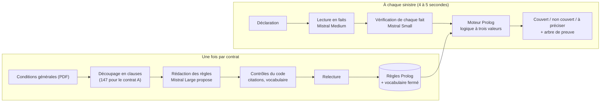
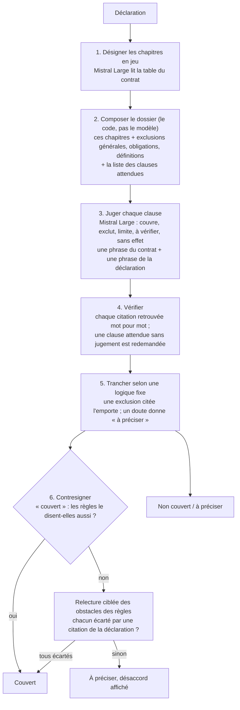

# Comprendre le projet : une enquête en deux hypothèses

Ce texte raconte une recherche : la question de départ, ce qui la rend difficile, la façon dont j'ai décidé de juger
mes résultats, une première hypothèse, ce que la mesure en a révélé, une seconde hypothèse née de cette découverte,
les difficultés rencontrées en chemin, et ce que j'en ai appris. Il ne demande aucune connaissance préalable, ni en
assurance ni en intelligence artificielle. Je ne viens pas de l'assurance moi non plus : j'ai appris le sujet en le
construisant.

Pour aller plus loin : [les explications](EXPLICATIONS.md) décrivent chaque fichier ; [la démarche](DEMARCHE.md) garde
chaque essai et sa mesure, dans l'ordre où je les ai faits, y compris les fois où la mesure m'a donné tort ;
[la fiche métriques](METRIQUES.md) détaille chaque mesure et ses seuils.

**En bref.** J'ai d'abord traduit les contrats en règles et laissé un programme décider : rapide, transparent, mais
faux dès que la traduction l'était, et sur des cas jamais vus il lui arrivait de promettre à tort. J'ai alors fait
lire au modèle les clauses mêmes du contrat, une à une, en vérifiant chaque citation et en calculant la décision
dans le code. Sur soixante déclarations que ni l'une ni l'autre méthode n'avait vues, la seconde répond juste 53 fois
contre 40, sans aucune promesse à tort, contre près de cinq pour la première. Elle coûte trois minutes et
quelques centimes par analyse. Puis je l'ai comparée à la solution la plus simple, tout le contrat donné au modèle en
une fois : elle ne répond pas plus juste, mais l'autre promet sept fois à tort et cite souvent des phrases qui ne sont
pas dans le contrat. Ce que ma construction apporte, c'est la prudence et la preuve, pas la justesse.

---

## 1. La question, et pourquoi elle compte

Quelqu'un rentre chez lui et trouve sa cave forcée, son vélo disparu. Il écrit à son assureur : « Mon vélo a été
volé dans ma cave. » De l'autre côté, un gestionnaire doit répondre à une seule question : **le contrat couvre-t-il
ce sinistre ?**

Pour répondre, il ouvre les « conditions générales », un document de 50 à 100 pages. Il y cherche la garantie vol,
lit ce qu'elle couvre, puis ce qu'elle exclut, puis le lexique, parce que le contrat donne aux mots un sens précis
(une « serrure de sûreté » n'est pas un cadenas). C'est long, et une erreur coûte dans les deux sens.

**Les enjeux.** Pour l'assureur, une réponse « couvert » donnée à tort est un paiement que le contrat ne prévoit pas,
multiplié par des milliers de dossiers. Pour l'assuré, un refus à tort est une injustice, et souvent une réclamation.
Pour le gestionnaire, c'est du temps : relire cent pages pour un vélo. Et pour tous, c'est une question de confiance :
une réponse qu'on ne peut pas justifier ne vaut rien, même juste. L'énoncé qui m'a été donné le disait à sa façon :
coller le contrat dans un assistant conversationnel ne suffit pas ; que faire à la place, et comment tenir des
centaines de contrats ?

**Ma question de recherche** : un système peut-il faire ce travail avec le gestionnaire, de façon vérifiable ? On lui
donne une déclaration écrite comme on parle ; il doit rendre :

- **la réponse** : couvert, non couvert, ou « à préciser » ;
- **la preuve** : la phrase exacte du contrat sur laquelle la réponse s'appuie, avec son numéro d'article ;
- **la question à poser**, quand la déclaration ne dit pas tout ce qu'il faut savoir.

## 2. Pourquoi c'est difficile

Mon projet précédent, SortirIA, est un assistant de sorties pour Montpellier : on lui écrit « un concert gratuit ce
week-end à Sète », il propose des sorties qui respectent la date, le lieu et le budget. Les deux projets se
ressemblent en apparence : une phrase en entrée, une réponse en sortie, un modèle de langage au milieu. Ils
diffèrent sur quatre points, et ce sont eux qui ont orienté toute ma conception.

| | SortirIA | Ce projet |
|---|---|---|
| Ce que fait le système | Il **recommande** | Il **décide** |
| Une réponse imparfaite | Reste utile : un concert un peu loin est encore une idée | Est une faute : « couvert » à tort est une promesse faite au client |
| Ce qu'il lit | Des fiches de sorties, courtes, ramenées à un même modèle | Des contrats de 50 à 100 pages, chacun écrit à sa façon |
| Ce qu'on attend de lui | Une bonne suggestion | Une réponse qu'on peut **vérifier** ligne à ligne |

J'ai rencontré trois difficultés qui n'existaient pas dans SortirIA.

**La phrase qui décide ne ressemble pas à la question.** Pour un vélo volé dans le hall de l'immeuble, la réponse
tient dans une exclusion qui parle de « parties communes du bâtiment ». Le mot « vélo » n'y est pas, le mot « hall »
non plus. Chercher les passages qui ressemblent à la question, comme le fait un moteur de recherche, ne suffit pas.

**Un contrat est fait d'exceptions d'exceptions.** Une garantie couvre le vol ; une exclusion retire le vol sans
effraction ; une option rachète cette exclusion pour certains biens ; une obligation (fermer à clé) peut faire tout
perdre. Il faut appliquer ces règles dans le bon ordre, sans en oublier une.

**« Je ne sais pas » doit rester « je ne sais pas ».** Si la déclaration ne dit pas comment la cave était fermée, on
ne peut ni couvrir ni refuser. Deviner est interdit.

**Le premier essai, et pourquoi je l'ai écarté.** Le plus simple était de donner le contrat et la déclaration à un
modèle de langage et de lui demander la réponse. Il répondait avec assurance, souvent juste, parfois faux sans que
rien ne le signale. Sur un banc public de questions d'assurance (LegalBench, 133 cas), il citait juste, mais
tranchait 90 % des cas que des lecteurs humains jugent ambigus. Surtout, je ne pouvais pas vérifier son
raisonnement : il ne le montre pas, il le raconte après coup. J'en ai tiré trois garde-fous, que mes deux
hypothèses respectent :

1. **Pas de réponse sans preuve.** Chaque phrase citée est recherchée mot pour mot par le code ; une citation qui
   n'existe pas fait écarter ce qu'elle devait prouver.
2. **Un doute ne fait jamais couvrir.** Tant qu'un fait décisif manque, la réponse est « à préciser », avec la question.
3. **Le code tranche, pas le modèle.** La décision finale sort d'une logique écrite à l'avance, qui donne toujours la
   même réponse aux mêmes entrées.

## 3. Comment je juge : la méthode et les métriques d'évaluation

Avant de construire quoi que ce soit, j'ai décidé comment je jugerais les résultats. C'est la partie du projet qui
a le plus changé ce que j'en ai conclu, et celle que je referais en premier.

### Les erreurs ne se valent pas

Une seule note de réussite cacherait l'essentiel. Je compte donc les erreurs par gravité, et je les lis dans cet ordre :

| Métrique | Ce qu'elle compte | Pourquoi elle compte |
|---|---|---|
| **Couverts à tort** | « Couvert » quand le contrat ne couvre pas | Une promesse faite au client, un paiement indu : l'erreur la plus grave, visée à zéro |
| **Refus à tort** | « Non couvert » quand le contrat couvre | Un client lésé |
| **Réponses justes** | La réponse attendue, ou une seconde réponse que les annotateurs ont jugée défendable | Le score général |
| Réponses exactes | La réponse attendue seulement, sans tolérance | Ce que la tolérance pourrait cacher |
| « À préciser » au lieu d'une réponse | Une question posée là où le texte suffisait | L'erreur la moins chère : elle coûte une question de plus. Mais à 100 % de « à préciser », le système ne se trompe jamais et ne sert à rien |
| Cas instables | Cas dont la réponse change d'un passage à l'autre | Un modèle de langage ne lit pas toujours deux fois de la même façon |
| Durée et coût d'une analyse | Médiane et 95e centile ; tokens envoyés et reçus | Ce que vit le gestionnaire, et ce que paie l'assureur |
| Citations retrouvées | Phrases citées présentes mot pour mot dans le contrat | La preuve elle-même |

Pour la première méthode, je mesure aussi la **lecture** à part : avec des faits « idéaux », écrits à la main pour
chaque cas, le moteur se trompe-t-il ? Puis avec les faits lus par le modèle ? Cela dit **où** naît une erreur :
dans les règles, ou dans la lecture.

Chaque banc a des **portes** : des seuils fixés à l'avance (aucun couvert à tort, au plus un refus à tort, au moins
85 % de réponses justes) ; la commande échoue si une porte ne passe pas, comme une évaluation rejouée en intégration
continue. Ces seuils ne se relâchent jamais sans le noter, avec la raison.

### Des cas qu'on n'a jamais regardés

Le piège que je connaissais de mes projets précédents : un jeu de test qui a servi à prendre des décisions flatte
toujours ce qu'on a décidé. Je l'ai pourtant retrouvé ici, et c'est la découverte centrale du projet (section 5).
Ma méthode s'est donc construite en couches :

1. **Le jeu de mise au point** (le *golden set*, une centaine de cas) : écrit en connaissant les règles, il sert à
   corriger. Il mesure la mise au point, pas la qualité.
2. **Les jeux écrits à l'aveugle**, soixante déclarations chacun, vingt par contrat. Des annotateurs qui n'ont lu que
   le texte des conditions générales, jamais mes règles ni mon code, écrivent les déclarations et la réponse attendue,
   avec l'article et la phrase exacte qui la fondent. J'ai fait écrire ces cas par des agents (Claude) plutôt que de
   les écrire moi-même, parce que je connais les règles : j'aurais écrit, sans le vouloir, des cas qu'elles savent
   traiter.
3. **Un second avis indépendant**, sans voir la première réponse. Les accords entrent dans le jeu ; un désaccord est
   arbitré sur le texte, par un troisième lecteur qui ne voit que le contrat et les deux avis. Au dernier jeu, j'ai
   écarté Mistral Large du second avis : c'est le modèle qui lit dans la méthode mesurée, et un jeu annoté par lui
   l'aurait favorisé s'ils se trompaient de la même façon.
4. **Une mesure unique, code figé.** Le code est enregistré avant ; le jeu est passé une fois ; les chiffres sont
   écrits tels quels, qu'ils soient bons ou non. Ensuite, le jeu est « vu » : il peut servir à corriger, mais plus à
   mesurer. Un nouveau tour de corrections demande un nouveau jeu.
5. **Un critère fixé avant chaque essai.** Quand j'essaie une règle, j'écris d'abord ce qui la fera garder ou retirer
   (par exemple : « plus de refus à tort corrigés que de refus justes perdus, aucun couvert à tort »), puis je mesure.

J'ai monté six jeux de cette façon : « fermé », « aveugle », « neuf », « quatre », « cinq », « six ». Chacun a été
mesuré une fois, puis il est devenu un jeu vu.

**Ce que cette méthode ne garantit pas.** Les réponses attendues viennent de lecteurs automatiques qui s'accordent,
pas d'un juriste. Un accord dit que le cas n'est pas ambigu pour qui lit le contrat ; il ne dit pas qu'un
professionnel le validerait. Et vingt cas par contrat, c'est peu : un écart de deux ou trois réponses ne veut rien dire.

## 4. Première hypothèse : « le modèle lit, la logique décide »

**L'idée.** Si je traduis chaque contrat, une fois pour toutes, en règles qu'un programme sait appliquer, le modèle
n'a plus qu'à transformer la déclaration en faits. La décision devient un calcul : reproductible, et traçable
jusqu'à la phrase du contrat. C'est le partage que j'avais retenu dans SortirIA (des règles pour ce qui doit être
respecté, le modèle pour le langage), poussé jusqu'au bout.

### Sa structure

Elle a deux temps : un travail lourd, une fois par contrat, puis une analyse rapide à chaque sinistre.

- *Découper.* Le programme lit le PDF, retire ce qui gêne (en-têtes, numéros de page, sommaire) et découpe le texte
  en clauses : une garantie, une exclusion, une définition du lexique, chacune avec son numéro d'article.
- *Traduire en règles.* Chaque garantie est réécrite en Prolog, un langage fait pour le raisonnement : son périmètre,
  ses conditions, ses obligations, ses exclusions, ses limites, chacune avec la phrase du contrat qu'elle traduit.
  Un modèle propose la traduction ; le code la contrôle ; je relis.
- *Un vocabulaire fermé.* Pour que règles et déclarations se rencontrent, une liste d'environ 250 faits possibles
  (l'événement, le bien, le lieu, la façon dont le local était fermé…), chacun avec la question à poser s'il manque.
- *Le moteur* reprend le raisonnement d'un gestionnaire : un périmètre contraire écarte la garantie ; une exclusion
  ne retire qu'une garantie qui s'applique ; un fait inconnu laisse la condition inconnue, et la réponse « à préciser ».

**Un exemple.** Le vélo dans la cave « fermée par un cadenas » : Mistral Medium en tire les faits (vol, vélo, cave,
cadenas) ; Mistral Small vérifie chaque fait et retire ce que la déclaration ne dit pas ; le moteur applique les
règles. La garantie vol pose une condition, « si ces locaux sont fermés avec une serrure de sûreté », et le lexique
dit qu'un cadenas n'en est pas une : **non couvert**. Sans les mots « fermée par un cadenas », le moteur ne sait pas :
**à préciser**, avec la question « Comment le local était-il fermé ? ». L'écran montre l'arbre de preuve : chaque
condition examinée, sa phrase du contrat, et le fait qui l'a rendue vraie, fausse ou inconnue.

J'ai préparé quatre contrats de quatre assureurs, rendus anonymes (A, B, C, D). A et B sont traduits en entier ; C
et D en partie, volontairement : C m'a servi à mesurer ce que coûte un contrat de plus, étape par étape.

### Ses forces et ses faiblesses

| Ce qu'elle fait bien | Ce qu'elle fait mal |
|---|---|
| **Rapide et peu chère** : quatre à cinq secondes, de petits modèles, peu de texte envoyé | **Elle ne vaut que ce que vaut sa traduction** : une exclusion oubliée, une définition trop étroite, et la décision est fausse, avec une citation exacte à l'appui |
| **Reproductible** : les mêmes faits donnent toujours la même décision | **Le vocabulaire est un goulot** : une situation qu'il ne sait pas nommer (« une fuite, mais pas le gel ») n'atteint pas la règle |
| **Une preuve condition par condition**, lisible par un gestionnaire | **Chaque contrat coûte** : découpage, rédaction, contrôles, et une relecture qui ne se réduit pas |
| **Elle sait demander** : une question par fait manquant ; la réponse du client donne la décision sans nouvel appel au modèle | **La lecture varie un peu** : même à température zéro, le modèle ne lit pas toujours deux fois la même chose |

## 5. La découverte : un jeu qui a servi ment

Sur le jeu de mise au point, les chiffres étaient excellents : 90 à 100 % de réponses justes, aucun couvert à tort.
Je m'en suis méfié, parce que je les avais sous les yeux en réglant.

J'ai donc fait écrire le jeu « aveugle », par des annotateurs qui n'avaient lu que les contrats, et je l'ai mesuré
une seule fois. Les chiffres sont tombés : 95 % sur A, 58 % sur B, 78 % sur D, avec des couverts à tort (un rocher
tombé d'un talus, que B exclut pour toutes ses garanties ; des bijoux volés, que D ne couvre que par option). En
cherchant pourquoi, j'ai trouvé deux causes, à parts à peu près égales : des règles mal ou pas traduites, et un
vocabulaire trop pauvre (une trottinette électrique lue comme un vélo).

J'ai corrigé, par des règles générales, puis mesuré un troisième jeu écrit après ces corrections, « neuf », qui
cherchait des situations moins courantes : **38 réponses justes sur 60, et 7 couverts à tort.** Un second tour de
corrections a suivi.

C'est là que j'ai compris. Deux tours de corrections qui ne font pas monter un jeu neuf ne désignent pas une liste de
défauts : ils désignent la méthode. L'hypothèse tenait sur un point, le système ne répondait jamais sans preuve. Elle
échouait sur un autre : la preuve était celle de la règle, et une règle peut mal traduire le contrat. Chaque contrat
neuf promettait le même travail, et les mêmes surprises.

## 6. Seconde hypothèse : « le modèle juge chaque clause, la logique tranche, les règles contresignent »

**L'idée.** Si le modèle lit le texte même du contrat, une clause que la traduction a manquée peut encore être vue.
Pour ne pas retomber dans le piège du premier essai (un modèle qui décide sans qu'on puisse le vérifier), je ne lui
pose jamais la question « est-ce couvert ? » : je lui fais juger les clauses une à une, je vérifie chaque citation,
et je calcule la décision dans le code. Et je garde la première méthode comme contre-pouvoir : un « couvert » n'est
rendu que si elle le dit aussi.

**D'où vient la forme.** Un article sur l'analyse de dossiers de sinistre (« Parse the Folder, Not Just the PDFs »)
m'a donné l'idée qui manquait. Son argument : l'absence d'une pièce ne se trouve pas par une recherche, elle ne rend
qu'un résultat vide ; on ne la constate que si l'on a écrit d'avance ce qui était attendu. C'était exactement mon
défaut vu de l'autre côté : ma chaîne ne savait pas qu'une exclusion manquait à son examen, parce que rien ne lui
disait ce qu'elle aurait dû examiner. J'ai donc écrit, pour chaque garantie, la liste des clauses qu'un gestionnaire
doit relire, et le code vérifie que chacune a reçu un jugement.

### Sa structure

Pour un sinistre, l'analyse prend deux à trois minutes, et l'écran en suit chaque étape. Le dossier compte de 70 à
près de 300 clauses selon le contrat et le sinistre. Une déclaration qui raconte plusieurs sinistres (un vol, et par
ailleurs une fuite) est d'abord découpée, et chaque sinistre est jugé à part. Quand il manque une information, la
question est une phrase ; le client y répond en mots, et la déclaration complétée est relue, mais seules les clauses
en doute et ce qui bloque leur garantie sont jugées à nouveau : c'est encore plus lent qu'avec la première méthode, où
la réponse du client donne la décision sans nouvel appel au modèle.

**Ce que cette hypothèse change, et que je dois assumer.** Dans la première, le modèle ne voyait que la déclaration
et ne décidait de rien. Dans la seconde, il voit le contrat et porte un jugement sur chaque clause. C'est plus de
pouvoir donné au modèle. Mes garde-fous le bornent : deux citations vérifiées par jugement, une logique fixe pour
trancher, une contresignature pour couvrir.

### Ses forces et ses faiblesses

| Ce qu'elle fait bien | Ce qu'elle fait mal |
|---|---|
| **Elle lit le texte même** : une clause que la traduction a manquée est encore vue | **Lente et plus chère** : deux à trois minutes, 8 à 9 centimes par analyse |
| **Elle promet beaucoup moins à tort** (section 8) | **Moins stable** : le modèle juge, et peut juger autrement d'un passage à l'autre |
| **Chaque jugement est cité deux fois** et vérifié ; une clause attendue sans jugement se voit | **Le code vérifie qu'une citation existe, pas qu'elle a un rapport avec le sinistre** : une exclusion juste mais hors de propos peut faire refuser |
| **Pour juger, elle n'a besoin que du contrat découpé** : en principe, ni règles ni vocabulaire | **Pour couvrir, elle dépend encore des règles** (la contresignature) ; et des règles incomplètes retiennent des « couvert » justes |

## 7. Les difficultés en chemin, et ce que j'en ai fait

Une recherche n'avance pas en ligne droite. Voici les obstacles qui m'ont le plus appris.

| La difficulté | Ce que j'ai observé | La solution, ou la limite assumée |
|---|---|---|
| **Découper un PDF** | Chaque mise en page est différente : numéros d'article absents, renvois à des pages (« reportez-vous à la page 19 ») | Un profil de découpage par contrat, et du code une fois sur quatre. Limite écrite |
| **Le modèle recopie ses exemples** | Montrés à la première étape, des exemples de lecture faisaient ajouter des denrées à un congélateur grillé | Gardés à la seule étape vérifiée |
| **Un vérificateur trop zélé** | Mistral Medium, excellent lecteur, refusait comme vérificateur 17 fois sur 288 un lieu ou un bien que la déclaration impliquait | Deux modèles : Medium lit, Small vérifie (17 refus tombent à 2). Les rôles se mesurent un par un |
| **La lecture varie** | À température zéro et graine fixe, un fer à repasser lu « accident » six fois, puis « dégât électrique », puis couvert à tort | Mesurer chaque jeu trois fois et compter les cas instables ; ne jamais promettre zéro |
| **Une citation exacte, hors de propos** | Avec la seconde méthode, une clause d'obligations citée mot pour mot pour refuser un dégât des eaux après le gel | Une limite assumée ; deux tentatives de relire les refus ont échoué (section 8) |
| **Le contre-pouvoir hérite des défauts** | Six écarts sur quinze au jeu « quatre » : la lecture couvrait à raison, les règles se trompaient, la réponse devenait « à préciser » | Une relecture ciblée des seuls obstacles que les règles opposent (section 8) |
| **Un hébergeur qui coupe à quatre minutes** | En ligne, une requête de plus de 240 secondes était interrompue | Une ligne vide toutes les quinze secondes pendant l'analyse : 279 secondes ont tenu |
| **Le coût** | Un dossier pèse un quart à un tiers du contrat, envoyé à chaque sinistre | Mettre en tête ce qui revient à chaque sinistre, pour le cache du fournisseur (12 à 18 % de la facture d'un cas) ; 50 analyses par jour en ligne |
| **Des contrats réels, des noms réels** | Le texte cite l'assureur, l'assisteur, les adresses | Anonymisation à l'ingestion, d'après une liste gardée hors du dépôt ; les PDF ne sont pas redistribués ; en ligne, seules les clauses citées se lisent |
| **Mesurer sans se flatter** | Trois cas d'un jeu « fermé » avaient fini par servir à corriger une règle | Un jeu neuf à chaque tour, une mesure unique, code figé (section 3) |

## 8. Les deux hypothèses face à face

### Première comparaison : le jeu « quatre »

Le 25 novembre au soir, code figé, j'ai passé un jeu jamais vu par les deux méthodes : la première trois fois (elle
est rapide, et sa lecture varie un peu), la seconde une fois.

| Jeu « quatre », 60 cas jamais vus | Première méthode (règles) | Seconde méthode (clauses) |
|---|---|---|
| Réponses justes | 42 sur 60 | 45 sur 60 |
| **Couverts à tort** | **4,3** | **1** |
| Refus à tort | 2 | 4 |
| « À préciser » au lieu d'une réponse | 8,7 | 10 |
| Durée d'une analyse | 3 à 6 secondes | 2 à 3 minutes |

Trois réponses justes de plus, c'est un écart que soixante cas ne distinguent pas du hasard. Sur le jeu « neuf », qui
m'avait servi à mettre la seconde méthode au point, l'écart était de 48 contre 38 : il avait fondu sur des cas neufs,
et c'est la meilleure illustration que je connaisse de la section 3. Ce qui tenait, c'était le sens des erreurs : un
couvert à tort au lieu de plus de quatre. **Mon critère venait de la section 1 : à justesse comparable, je préfère
le système qui promet le moins souvent à tort.** J'ai fait de la seconde méthode la méthode par défaut.

Quatre cas où elles divergent, tous chez A, disent bien leur caractère :

- *Le casier du club de tennis forcé* (attendu : non couvert). La première répond « à préciser » les trois fois. La
  seconde trouve l'exclusion et la cite : « le vol du contenu entreposé dans un casier d'une association sportive ou
  d'agrément ». C'est exactement le gain que j'espérais.
- *Le store banne arraché par la tempête* (attendu : non couvert). La première le couvre deux fois sur trois.
  La seconde trouve l'exclusion des objets à l'extérieur, mais répond « à préciser ». Pas juste, mais l'erreur grave
  est évitée.
- *L'eau d'une gouttière voisine entrée par une fenêtre* (attendu : couvert). La première refuse. La seconde couvre,
  mais la contresignature voit le refus des règles et rend « à préciser » : mon contre-pouvoir hérite de l'erreur de
  ce qu'il contresigne.
- *Un dégât des eaux après le gel* (attendu : à préciser). La première répond juste. La seconde cite une clause
  d'obligations hors de propos et refuse : ma contresignature ne l'arrête pas, je ne l'avais prévue que pour les « couvert ».

### Un dernier tour, en généralisant

J'ai rangé les quinze écarts de la seconde méthode en cinq familles, et cherché pour chacune une règle générale,
jamais une retouche d'un cas. Les rejeux sur les jeux vus ne mesurent rien : ils vérifient qu'une règle fait ce
qu'elle dit et ne casse rien.

| Famille d'écarts | Ce que j'ai essayé | Décision |
|---|---|---|
| La contresignature tire vers le doute (6) | Reposer au modèle une seule question par obstacle que les règles opposent, citation de la déclaration exigée ; ne couvrir que si tous sont écartés | **Gardée** : trois « couvert » justes retrouvés, aucun couvert à tort nouveau |
| Une absence de couverture face à des règles qui hésitent (2) | Une absence sans exclusion citée ne l'emporte pas sur des règles qui disent « couvert » ou « à préciser » | **Gardée** |
| Un doute qui ne peut pas faire couvrir (2) | Un chapitre sans garantie ne tient plus la réponse en suspens | **Gardée** |
| Un refus cité hors de propos (2) | Relire la clause qui refuse, seule : un refus à tort corrigé, sept refus justes perdus. Puis relue dans tout son dossier : deux corrigés, cinq perdus | **Retirée deux fois** : le critère, fixé avant, n'était pas atteint |
| Les petits restes (3) | Pas de règle générale sûre | **Une limite écrite** |

L'échec du quatrième point m'a appris quelque chose de plus que sa réussite ne l'aurait fait : demander au modèle
« cette clause s'applique-t-elle ? » le fait douter de refus justes plus souvent qu'il ne corrige de refus à tort,
avec ou sans le contexte. Et une sortie uniforme (« inconnu » partout) m'a d'abord trompé : c'était mon code qui ne
reconnaissait pas l'identifiant recopié par le modèle. Je lis maintenant les réponses brutes avant de conclure.

### La mesure finale : le jeu « cinq »

Un jeu neuf, monté de la même façon, second avis sans Mistral Large ; code figé le 26 novembre, une seule passe.

| Jeu « cinq », 60 cas jamais vus | Première méthode (règles, 3 passages) | Seconde méthode (clauses, 1 passage) |
|---|---|---|
| — contrat A | 15,7 sur 20 | 20 sur 20 |
| — contrat B | 14,3 sur 20 | 19 sur 20 |
| — contrat D | 10,3 sur 20 | 14 sur 20 |
| **Réponses justes** | **40,3 sur 60** | **53 sur 60** |
| **Couverts à tort** | **4,7** | **0** |
| Refus à tort | 6 | 1 |
| « À préciser » au lieu d'une réponse | 9 | 6 |
| Durée d'une analyse (médiane) | 3,5 à 5,2 secondes | 177 secondes (167 sur 384 analyses) |

**Ce que je peux affirmer.** Sur le même jeu, l'écart est net cette fois : treize réponses justes de plus, dans le
même sens sur les trois contrats, aucun couvert à tort contre près de cinq, un refus à tort contre six. Et la
première méthode, à peu près inchangée entre les deux jeux, ne trouve pas celui-ci plus facile (40 contre 42) : le
dernier tour a servi.

**Ce que je lis dans les erreurs.** Le seul refus à tort : des clés volées dans un sac au café ; on demandait le
changement des serrures, et la lecture a appliqué l'exclusion des vols à la tire, qui vise le vol, pas la serrure.
C'est la famille « citation exacte, hors de propos ». Les six « à préciser » sont tous chez D, et tous du même type :
la lecture concluait « couvert », à raison ; les règles de D, traduites en partie, ne suivaient pas. Sans la
contresignature, ces six réponses auraient été justes. Je ne la retire pas pour autant : décider de la retirer en
voyant ce jeu serait régler le système sur le jeu qui le mesure. C'est une piste pour un jeu neuf.

**Et si je la repasse ?** La chaîne de règles passe chaque jeu trois fois ; la lecture des clauses, une seule. Le soir
même, j'ai repassé dix cas par contrat deux fois de plus. Sur ces trente cas, les trois passes donnent 26, 25 et 23
réponses justes : la première avait eu un peu de chance. Le jeu entier, repassé quatre fois, donne 51 réponses
justes sur 60 en moyenne (85 %) : c'est le niveau à attendre.
Sept cas sur trente changent de réponse, bien plus que la chaîne de règles. Ce qui me rassure, c'est le sens de ces
changements : aucun ne passe de « couvert » à « non couvert ». Chaque fois, une réponse franche devient « à préciser »,
ou l'inverse. Sur quatre-vingt-dix analyses, toujours aucun couvert à tort. En lisant les sorties, je vois d'où vient
la variation : le modèle ne désigne pas les mêmes chapitres d'une passe à l'autre (un même cas a eu 92 clauses au
dossier, puis 290), et la contresignature transforme alors un désaccord en « à préciser ». L'instabilité coûte des
questions au client, pas des promesses fausses.

**Et si j'ajoute les garanties que trouvent les règles ?** C'était la piste. Trois passes de plus : 82 % avant comme
après, autant de cas instables. L'hypothèse était fausse : la garantie manquait rarement au dossier. Je l'ai écrit,
et j'ai corrigé ce que les sorties montraient vraiment : une erreur passagère du fournisseur que le code ne relançait
pas.

**Et les « couvert » trop rapides ?** J'ai ajouté deux règles à la consigne du modèle : une cause seulement probable
n'est pas établie ; une garantie qui pose une condition ne couvre que si la déclaration la remplit. Puis un sixième jeu,
« six », écrit pour se jouer sur ces détails. Résultat : 46 réponses justes sur 60, un seul couvert à tort. Les cas
laissés « à préciser », repassés avec l'ancienne consigne, auraient donné trois couverts à tort de plus, et deux
réponses justes de plus. Je garde les deux règles : une question vaut mieux qu'une promesse fausse.

**Et si je m'en sers ?** Le lendemain, j'ai tapé six déclarations sur le site, comme le ferait la personne qui le
découvre. Les mesures comptent des décisions ; l'essai montre ce que le client lit, et il a trouvé ce qu'aucun banc ne
voyait. Quand les deux lectures du contrat n'étaient pas d'accord, la réponse devenait « à préciser »… sans une seule
question : la lecture des clauses n'avait pas de doute, et les questions des règles se perdaient. Une déclaration à
deux sinistres recevait un seul badge, alors que l'API calculait une décision pour chacun. Un refus disait « aucune
garantie ne porte sur cet événement » pour une table de jardin qui avait brûlé, sans rien citer. Tout cela est
corrigé, sans changer une seule décision : les questions des règles sont posées, chaque sinistre a son cadre, et le
refus nomme la garantie incendie et la définition du contenu qui écarte la table. Restent les erreurs du modèle
lui-même, que je n'ai pas corrigées : un congélateur arrêté « sûrement à cause d'une panne électrique » reçu comme
couvert, alors que la cause n'est pas établie et que la clause demande un arrêt de six heures. Là, rien ne l'a
arrêté : les règles n'ont pas contredit. C'est le vrai risque de cette méthode.

**Et face à la solution la plus simple ?** C'est la question qu'un professionnel pose en premier, et je l'ai posée en
dernier : toute ma construction se justifie-t-elle face à un modèle à qui l'on donne tout le contrat et la déclaration,
en lui demandant la réponse ? Je l'ai passée sur les mêmes soixante cas, pour 1,36 $. Elle répond juste 52 fois, ma
méthode 51 en moyenne : à égalité. Elle est quatre fois moins chère et six fois plus rapide. Mais elle promet sept
fois à tort, et presque toujours de la même façon : une garantie qui n'existe qu'en option (la panne d'électroménager,
l'annulation de voyage) est tenue pour souscrite. Sur ces cas, ma méthode répond « à préciser » à chaque fois,
parce que la règle fixe le veut : une option ne couvre pas seule ; elle ne couvre aucun des sept. Et plus de la moitié de ses citations ne se
retrouvent pas dans le contrat. La leçon est double. Ma construction ne lit pas mieux : elle est plus prudente, et
elle prouve. Et une version plus simple, qui garderait cette prudence et cette preuve sans le reste, est à essayer.
J'aurais dû mesurer cette solution simple en premier.

### Les deux méthodes en un tableau

| | Première méthode (règles) | Seconde méthode (clauses) |
|---|---|---|
| Ce que voit le modèle | La déclaration seule | La déclaration et les clauses du contrat |
| Qui décide | Un moteur, sur des règles traduites | Une logique fixe, sur des jugements cités, contresignée par les règles |
| Travail par contrat | Découpage, traduction, vocabulaire, relecture humaine | Découpage et clauses attendues ; les règles servent à contresigner |
| Où elle se trompe | À la traduction : une règle fausse, un fait que le vocabulaire ne connaît pas | À la lecture : une clause mal jugée, une citation exacte mais hors de propos |
| Le raisonnement montré | Un arbre de preuve, condition par condition | Le jugement de chaque clause, avec ses deux citations |
| Même réponse deux fois ? | Presque : 0 à 4 cas sur 96 changent | Non : 11 cas sur 60 sur quatre passes, presque toujours entre une réponse franche et « à préciser » |
| Justesse sur le jeu « cinq » | 40 sur 60, 4,7 couverts à tort | 53 sur 60 en une passe, 51 en moyenne sur quatre, aucun couvert à tort |
| Durée, coût | Quelques secondes, très peu | Deux à trois minutes, 8 à 9 centimes |

Les deux restent dans le produit. À l'écran, une liste « Méthode » sur la ligne de la déclaration laisse choisir :
la lecture des clauses par défaut, la chaîne de règles en cinq secondes. On peut lancer la même déclaration avec
l'une puis l'autre, et voir la différence.

## 9. Ce que j'ai appris

**Sur la méthode de recherche.**

- *Un jeu qui a servi à corriger flatte ce qu'on a corrigé.* Je le savais ; je l'ai vu deux fois de plus ici (90 %
  sur le jeu fermé de B devenus 58 % sur un jeu neuf, un écart de 48 contre 38 fondu à 45 contre 42). Un jeu neuf à chaque tour n'est pas un luxe.
- *Fixer le critère avant de mesurer* m'a évité de garder une règle séduisante : la relecture des refus corrigeait de
  vraies erreurs, et elle en créait davantage.
- *Une erreur ne se résume pas à un taux.* Le sens des erreurs (couvrir à tort ou refuser à tort) a décidé de mon
  choix, pas le score général.
- *Lire les réponses brutes avant de conclure* : une fois sur deux, une sortie étrange vient de mon propre code.

**Sur les modèles de langage.**

- Un modèle sait dire si un fait est **écrit** ; il se corrige mal sur le choix d'une **catégorie** ; et un bon
  lecteur n'est pas forcément un bon vérificateur. Les rôles se confient un par un, au modèle qui les tient le mieux.
- Le plus sûr n'est pas de faire décider le modèle, ni de l'en empêcher : c'est de lui faire **juger des pièces
  vérifiables** (une clause, deux citations) et de laisser le code assembler la décision.
- La température zéro ne rend pas un modèle déterministe. La stabilité se mesure ; elle ne se décrète pas.

**Sur le métier.** Je ne viens pas de l'assurance. Écrire les règles m'a appris à lire un contrat comme un
gestionnaire : la garantie, puis ses conditions, puis les exclusions, puis le lexique, puis les exceptions aux
exclusions. Et à respecter la réponse « à préciser » : dans ce métier, une bonne question vaut mieux qu'une réponse
devinée.

**Sur la mise en production.** Un service qui répond en trois minutes demande d'autres choix qu'un service qui
répond en trois secondes : suivre l'analyse à l'écran, tenir la connexion ouverte, compter les analyses par jour,
annoncer le coût. Ce que j'avais appris avec SortirIA (seuils fixés avant, évaluation rejouée, suivi, budget) s'est
appliqué ici presque tel quel.

## 10. Ce qui reste ouvert

- **Les bonnes réponses n'ont pas été relues par un juriste.** Des annotateurs automatiques concordent : cela dit que
  les cas ne sont pas ambigus pour qui lit le contrat, pas qu'un professionnel les validerait tous. Et la seconde
  méthode lit le contrat avec un modèle, comme les annotateurs : si un modèle et un juriste comprennent une clause
  différemment, le jeu la favorise. Je ne crois pas que cela explique treize points d'écart, mais je ne peux pas
  l'exclure. C'est la première chose à faire avant tout usage réel.
- **La seconde méthode n'a jamais été passée seule.** Sans contresignature, sur un contrat sans règles traduites,
  elle supprimerait le travail de traduction : c'est là qu'est le vrai gain pour des centaines de contrats. Relue
  dans les sorties déjà faites, elle répond plus souvent juste sans les règles (90 % au lieu de 83 %), mais promet
  neuf fois à tort au lieu d'une : il lui faudrait une autre garde.
- **Le modèle concluait parfois « couvert » trop vite**, quand la déclaration hésite (« sûrement ») ou ne dit pas une
  condition de la clause. Deux règles de lecture l'ont réduit (trois couverts à tort évités sur le jeu « six ») ; elles
  prennent parfois une obligation de l'assuré pour une condition de la garantie, ce qui coûte une réponse juste.
- **Les jeux sont petits** : vingt cas par contrat.
- **Ce n'est pas un service en production** : la démonstration en ligne n'a pas d'utilisateurs réels.
- **Seulement l'habitation** : aucun contrat d'une autre branche (auto, prévoyance) n'a été essayé ; la lecture est
  écrite pour des dommages aux biens.
- **Il ne dit rien du montant** : il répond à « est-ce couvert ? », pas à « combien ? ».

**Les prochaines expériences, dans l'ordre.**

1. Essayer la version simple que suggère la comparaison : tout le contrat en un appel, puis la même règle fixe et le
   même contrôle des citations. Et mesurer la seconde méthode sans contresignature, sur un contrat jamais traduit.
2. Ne faire contresigner que par des règles complètes : un contrat traduit en partie retient des « couvert » justes
   plus souvent qu'il n'arrête une erreur.
3. Faire relire un jeu par quelqu'un du métier, et mesurer l'écart avec les annotateurs automatiques.
4. Rendre la lecture plus stable. Ajouter les garanties des règles n'a pas suffi : il faudra chercher ailleurs (les
   citations jugées inexactes, une même clause jugée autrement d'une passe à l'autre).
5. Mesurer ce que la relecture partielle (seules les clauses en doute, après les réponses du client) fait gagner en
   attente, et ce qu'elle coûte en justesse.

Chacune demandera un jeu de cas neuf : « cinq » et « six » ont servi.

## 11. En une phrase

J'ai d'abord traduit les contrats en règles et laissé un programme décider : rapide et transparent, mais faux dès
que la traduction l'était ; j'ai alors fait juger au modèle les clauses mêmes, une à une, chaque citation vérifiée et
la décision calculée par le code : sur des cas jamais vus, il répond juste 53 fois sur 60 au lieu de 40 et ne promet
plus à tort, au prix de trois minutes d'attente ; face à la solution la plus simple, il ne répond pas plus juste, mais
il ne promet pas à tort et il prouve ce qu'il dit.

*Les réponses attendues ont été établies d'après le texte des conditions générales, par des annotateurs
automatiques qui s'accordent ; elles sont à relire par un juriste.*
